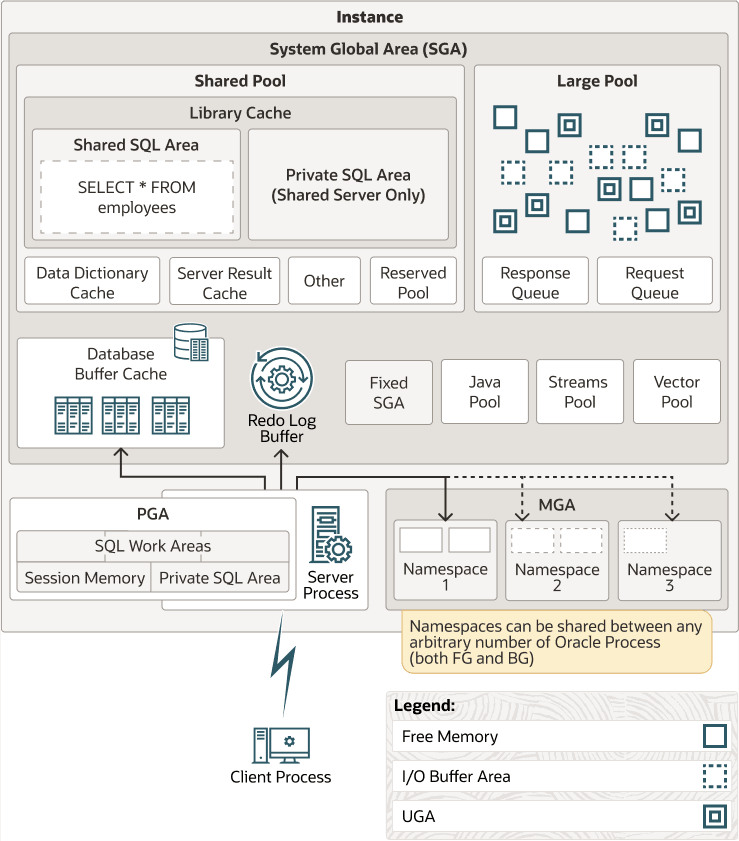

# Mémoire d'instance Oracle — SGA et PGA depuis l'étape 0

Un guide pratique qui commence par **pourquoi la mémoire existe**, construit un modèle
mental, nomme chaque structure mémoire, et se termine par **comment inspecter, redimensionner
et régler chacune** à l'aide de `ALTER SYSTEM`, `ALTER SESSION` et des vues `V$`.

> Cible : Oracle Database 23ai Free (notes pour 19c ; **MGA** et **Unified Memory** sont des
> fonctionnalités d'Oracle AI Database **26ai**).
> **Oracle Database Free se limite à 2 CPU, 2 Go de RAM (SGA + PGA combinés) et 12 Go de
> données utilisateur** — voir [8.0](#80-prérequis-le-conteneur-et-le-schéma-hr-dexemple).
> Les exemples font référence à `HR.employees`, qui n'est *pas* fourni à partir de 21c ;
> installez-le selon [8.0](#80-prérequis-le-conteneur-et-le-schéma-hr-dexemple). L'exemple
> fil rouge est `UPDATE employees SET salary = 5000 WHERE employee_id = 100;` puis `COMMIT;`.
> Fichier compagnon : `oracle_architecture.png` ; chaque bloc est couvert — voir la
> [liste de contrôle de couverture du schéma](#étape-10--liste-de-contrôle-de-couverture-du-schéma).
>
> **Numérotation.** La Partie 0 utilise les **Fondations A…E** (A = NAND, B = von Neumann,
> C = théorie des OS, D = contrat OS/matériel, E = correspondance Oracle) avec les
> sous-sections `A.1`, `B.2`, … afin de ne jamais entrer en collision avec **l'Étape 0…11**
> et les sous-sections `3.1`, `4.4`, … de la Partie I.
> *Fondation* et *Étape* sont deux espaces de noms distincts, volontairement.

---

## Table des matières

**Partie 0 — Fondations (à lire en premier)**
- [Fondation A — D'une porte NAND à l'architecture des ordinateurs](#fondation-a--dune-porte-nand-à-larchitecture-des-ordinateurs)
- [Fondation B — Architecture des ordinateurs : la machine de von Neumann](#fondation-b--architecture-des-ordinateurs--la-machine-de-von-neumann)
- [Fondation C — Théorie des systèmes d'exploitation](#fondation-c--théorie-des-systèmes-dexploitation)
- [Fondation D — Comment la théorie des OS s'applique à l'architecture](#fondation-d--comment-la-théorie-des-os-sapplique-à-larchitecture)
- [Fondation E — Comment tout cela s'applique à la base de données Oracle](#fondation-e--comment-tout-cela-sapplique-à-la-base-de-données-oracle)

**Partie I — Mémoire d'instance Oracle**
0. [Le problème que la mémoire résout (commencez ici)](#étape-0--le-problème-que-la-mémoire-résout-commencez-ici)
1. [Instance vs. base de données vs. session](#étape-1--instance-vs-base-de-données-vs-session)
2. [SGA vs. PGA en un coup d'œil](#étape-2--sga-vs-pga-en-un-coup-dœil)
3. [Comment Oracle décide des tailles : manuel, ASMM, AMM, unifié](#étape-3--comment-oracle-décide-des-tailles--manuel-asmm-amm-unifié)
4. [Les composants de la SGA, un par un](#étape-4--les-composants-de-la-sga-un-par-un)
5. [Les composants de la PGA, un par un](#étape-5--les-composants-de-la-pga-un-par-un)
6. [MGA (Managed Global Area) et namespaces](#étape-6--mga-managed-global-area-et-namespaces)
7. [Comment manipuler la mémoire (la boucle en quatre étapes)](#étape-7--comment-manipuler-la-mémoire-la-boucle-en-quatre-étapes)
8. [Atelier pratique (SQL copier-coller)](#étape-8--atelier-pratique-sql-copier-coller)
9. [Aide-mémoire : paramètres, vues, symptômes](#étape-9--aide-mémoire--paramètres-vues-symptômes)
10. [Liste de contrôle de couverture du schéma](#étape-10--liste-de-contrôle-de-couverture-du-schéma)
11. [Considérations de sécurité](#étape-11--considérations-de-sécurité)

**Références**
- [Glossaire](#glossaire)
- [Questions d'entraînement (avec réponses)](#questions-dentraînement-avec-réponses)
- [Références](#références)

---

## Partie 0 — Fondations : d'une porte NAND à la SGA

> Lisez cette partie en premier si des termes comme *MMU*, *adresse virtuelle*, *commutation de
> contexte*, *défaut de page* ou *cache write-back* ne sont pas encore automatiques. Tout ce
> qu'Oracle fait avec la SGA et la PGA est une application des idées ci-dessous.

Trois couches, chacune virtualisant la couche située en dessous :

```
+----------------------------------------------------------------+
| APPLICATION / BASE DE DONNÉES  (Oracle)                        |
|   construit ses propres caches, ordonnanceurs, verrous,        |
|   et journal d'écriture anticipée (write-ahead log)            |
+----------------------------------------------------------------+
| SYSTÈME D'EXPLOITATION                                         |
|   virtualise CPU, mémoire et disque pour chaque processus      |
+----------------------------------------------------------------+
| MATÉRIEL  (machine de von Neumann)                             |
|   CPU + MMU + RAM + TLB + interruptions + bus + E/S            |
+----------------------------------------------------------------+
```

---

### Fondation A — D'une porte NAND à l'architecture des ordinateurs

> Si vous n'avez jamais vu comment une poignée de portes logiques devient un CPU, voici la
> version « vue de 3 000 mètres ». Le parcours pratique canonique est *nand2tetris* (Nisan &
> Schocken, *The Elements of Computing Systems*) ; ce qui suit en est la colonne vertébrale et
> correspond à ses projets : **Projet 1** = NAND/portes (§A.2), **Projet 2** = l'ALU (§A.3),
> **Projet 3** = circuits séquentiels & registres (§A.4), **Projet 4** = langage machine
> (l'ISA), **Projet 5** = le CPU et l'ordinateur complet (§A.5), **Projet 6** = l'assembleur
> (§A.6).

Toute la machine est construite par **empilement d'abstractions** — chaque niveau cache le
désordre du niveau inférieur et expose une interface propre au niveau supérieur :

```
  application ──► jeu d'instructions (ISA) ──► CPU + mémoire ──►
  ... ──► portes logiques (NAND) ──► transistors (interrupteurs) ──► atomes
```

Lisez de bas en haut : les atomes font les transistors, les transistors font les portes, les
portes font les circuits, les circuits font le CPU/la mémoire, et ceux-ci réalisent un jeu
d'instructions.

#### A.1 Transistor → interrupteur → bit
- Un **MOSFET** est un interrupteur commandé en tension : une tension de grille ouvre ou ferme
  un canal. Associez « ouvert/fermé » à **1/0** et vous obtenez un signal **binaire**.
- Abstraction : cessez de penser en tensions et pensez en **valeurs booléennes**. C'est la
  naissance de la **logique numérique**.
- Des millions à des milliards de ces interrupteurs sur une seule puce. La **loi de Moore**
  (le nombre de transistors double à peu près tous les ~2 ans) explique pourquoi l'échelle
  ci-dessous a pu devenir si haute.

#### A.2 La porte NAND : le bloc de construction universel
Une **porte logique** calcule une fonction booléenne de ses entrées. **NAND** vaut 0 seulement
lorsque *toutes* les entrées valent 1 :

| A | B | A NAND B |
|---|---|---|
| 0 | 0 | 1 |
| 0 | 1 | 1 |
| 1 | 0 | 1 |
| 1 | 1 | 0 |

**NAND est « universelle » :** *toute* fonction booléenne peut être construite à partir de
portes NAND seules, ce qui explique pourquoi les puces sont conçues en ces termes :

```
NOT(a)   = NAND(a, a)
AND(a,b) = NOT(NAND(a,b)) = NAND(NAND(a,b), NAND(a,b))
OR(a,b)  = NAND(NOT a, NOT b)                 -- loi de De Morgan
XOR(a,b) = NAND( NAND(a, NAND(a,b)), NAND(b, NAND(a,b)) )
```

Construisez NOT, AND, OR, XOR et vous pouvez tout construire d'autre (MUX, décodeur,
comparateur…).

#### A.3 Circuits combinatoires : des portes au ALU
Câblez des portes ensemble **sans mémoire** et vous obtenez de la **logique combinatoire** —
la sortie ne dépend que des entrées courantes :

- **Additionneurs :** le demi-additionneur (XOR pour la somme, AND pour la retenue) et
  l'**additionneur complet** (prend une retenue entrante). Chaînez-les pour un **additionneur à
  propagation de retenue** ; utilisez l'anticipation de retenue pour aller plus vite. C'est de
  l'arithmétique, faite de NAND.
- **Multiplexeur (MUX) :** sélectionne une entrée parmi N — le « si » fondamental.
- **Décodeur :** transforme une adresse de N bits en une seule ligne active — c'est ainsi que
  la mémoire et les bancs de registres sont sélectionnés.
- **ALU (Unité Arithmétique et Logique) :** un ensemble de fonctions (add, sub, and, or, not,
  compare) plus une **entrée de commande** qui choisit laquelle. **C'est l'ALU que la
  Fondation B liste comme composant du CPU.**

#### A.4 Circuits séquentiels : la mémoire par rétroaction
Renvoyez la sortie d'une porte vers son entrée et le circuit **se souvient** — c'est là que
naît un bit de mémoire :

- **Bascule SR :** deux **portes NAND couplées en croix** ; elle retient un bit.
- **Bascule D (D flip-flop) :** une bascule horlogée, déclenchée sur front (une paire
  maître–esclave) qui stocke sûrement une valeur sur un front d'horloge. **C'est la cellule
  mémoire de 1 bit d'un registre.**
- **Registre :** N bascules partageant une même **horloge** — stocke un mot de N bits.
- **Banc de registres (register file) :** un tableau de registres + un **décodeur** (pour en
  choisir un) + un **MUX** (pour router une valeur en sortie). Petit, rapide, à l'intérieur du
  cœur du CPU.
- **Compteur / compteur de programme (PC) :** un registre qui s'incrémente — pilote le cycle de
  recherche d'instruction.
- Une **horloge** (un oscillateur) donne à tout un battement ; les circuits séquentiels ne
  changent que sur les fronts d'horloge.

#### A.5 Assembler les composants : CPU + mémoire
Combinez les blocs et vous obtenez les parties de von Neumann de la Fondation B :

```
  +----------------------------- CPU ------------------------------+
  |   unité de commande (décode les instructions, pilote le datapath)|
  |   ALU            (combinatoire : arithmétique + logique)        |
  |   registres      (bascules ; PC, SP, usage général)             |
  +----------------|-------------------|---------------------------+
                   |  bus d'adresses    |  bus de données/commande
  +----------------|-------------------|---------------------------+
  |   mémoire : RAM (registres adressés par un décodeur) + ROM/BIOS |
  +-----------------------------------------------------------------+
                   |
      Périphériques d'E/S (contrôleurs, DMA)  <── interruptions ── CPU
```

- **Unité de commande :** lit l'instruction, fixe l'opération de l'ALU et les validations de
  registres — c'est de la logique combinatoire plus de l'état.
- **Mémoire :** un grand tableau de mots adressables, construit à partir de cellules SRAM/DRAM.
- **L'idée de programme stocké** (Fondation B) : parce que les instructions vivent dans la même
  mémoire que les données, le même matériel recherche/décode/exécute *n'importe quel* programme.

#### A.6 Le jeu d'instructions (ISA) et l'assembleur
Le CPU et la mémoire ci-dessus ne sont utiles que lorsque matériel et logiciel s'accordent sur
un **vocabulaire d'instructions** — l'**architecture du jeu d'instructions (ISA)** (le
**Projet 4** de nand2tetris vous donne le langage machine ; le **Projet 6** écrit un
**assembleur** qui traduit les mnémoniques en ce langage) :

- Une **instruction** encode un **code opération** (quoi faire) plus des **opérandes**
  (registres, une valeur immédiate ou une adresse mémoire). Classes typiques :
  arithmétique/logique, chargement/stockage, branchement/saut, et appels système.
- Les **modes d'adressage** (immédiat, registre, direct, indirect, indexé) décident comment un
  opérande nomme ses données.
- L'ISA est le **contrat** : le matériel peut être construit comme vous voulez tant qu'il
  implémente l'ISA ; compilateurs et assembleurs ciblent l'ISA, pas les transistors.
- L'**assembleur** est la forme lisible par l'humain de ce contrat (`ADD R1, R2, R3`), et un
  **assembleur** le traduit en binaire que le CPU recherche. C'est la couche sur laquelle le
  code compilé d'Oracle s'exécute finalement — la même boucle recherche/décode/exécute, des
  milliards de fois par seconde.

#### A.7 Le bit physique : SRAM, DRAM, flash
La « cellule mémoire de 1 bit » ci-dessus est réalisée dans le silicium de quelques manières —
et c'est là que repose physiquement l'histoire mémoire d'Oracle :

- **SRAM** — ~6 transistors par bit, rapide, sans rafraîchissement → **caches CPU** (L1/L2/L3)
  et TLB.
- **DRAM** — 1 transistor + 1 condensateur par bit, dense/bon marché, nécessite un
  **rafraîchissement** périodique, plus lente → **mémoire principale**, c'est-à-dire là où
  vivent la **SGA et la PGA**.
- **Flash NAND** — cellules à grille flottante (nommées d'après la disposition **NAND**, pas la
  porte logique), non volatile → **SSD**, là où vivent les **fichiers de données et les journaux
  de redo** d'Oracle.

Ainsi l'échelle se referme : le NAND qui construit la logique est l'ancêtre du bit, le bit est
l'ancêtre de la DRAM, et la DRAM est là où se trouve physiquement le cache de tampons de la SGA.

**Passage de relais :** avec les portes, nous avons construit le CPU et la mémoire. La Fondation B
décrit maintenant ces composants du point de vue de l'architecture.

---

### Fondation B — Architecture des ordinateurs : la machine de von Neumann

#### B.1 L'idée unique : un programme stocké
Presque tous les ordinateurs que vous toucherez suivent l'**architecture de von Neumann**
(John von Neumann, *First Draft of a Report on the EDVAC*, 1945). Sa caractéristique
définissante est le **concept de programme stocké** : **instructions et données vivent dans la
même mémoire**, et le CPU les recherche et les exécute dans un cycle.

- **Rechercher (fetch)** l'instruction à l'adresse pointée par le compteur de programme (PC).
- La **décoder** dans l'unité de commande.
- L'**exécuter** (opération de l'ALU, accès mémoire ou branchement).
- **Stocker** le résultat et avancer le PC. Répéter.

À l'opposé : une **architecture Harvard** possède des mémoires séparées pour les instructions
et les données (courante dans les microcontrôleurs et dans les caches d'instructions/données
des CPU modernes).

#### B.2 Les composants
- **CPU (unité centrale de traitement)**
  - **Unité de commande** — recherche/décode les instructions et pilote le datapath.
  - **ALU (unité arithmétique et logique)** — arithmétique entière/bit à bit ; l'unité de calcul
    en virgule flottante (FPU) fait le flottant.
  - **Registres** — le stockage le plus rapide, à l'intérieur du cœur :
    - `PC` (compteur de programme), `IR` (registre d'instruction)
    - `SP` (pointeur de pile), registres à usage général, statut/drapeaux
    - `MAR`/`MDR` (registres d'adresse / de données mémoire) dans le modèle classique.
- **Mémoire principale (RAM)** — un tableau linéaire d'octets/mots adressables contenant à la
  fois le *code* et les *données*. Adresse **0 … 2^N − 1**.
- **Bus** — **bus d'adresses** (où), **bus de données** (quoi), **bus de commande** (comment).
- **Périphériques + contrôleurs d'E/S** — stockage, NIC, GPU, minuteries ; dialoguent avec le
  CPU via des interruptions et avec la mémoire via le DMA.
- **Stockage secondaire persistant** — disques/SSD. Pas strictement partie du modèle de base,
  mais essentiel car la RAM perd son contenu en cas de coupure de courant.

#### B.3 La hiérarchie mémoire et le goulot d'étranglement de von Neumann
Le CPU est bien plus rapide que la DRAM, donc une conception à mémoire unique unique fait perdre
au CPU l'essentiel de son temps en attente. Cette limite de débit est le **goulot
d'étranglement de von Neumann**. Il est atténué par une **hiérarchie de caches** qui exploite la
**localité de référence** (*temporelle* : récemment utilisé → réutilisé ; *spatiale* : les
voisins → utilisés ensemble) :

| Niveau | Latence typique | Taille |
|---|---|---|
| Registres | < 1 ns | centaines d'octets |
| Cache L1 | ~1 ns (≈ 4 cycles) | dizaines de Ko |
| Cache L2 | ~4 ns (≈ 12 cycles) | centaines de Ko–Mo |
| Cache L3 | ~10–20 ns (≈ 40 cycles) | dizaines de Mo (partagé) |
| DRAM (mémoire principale) | ~60–100 ns | Go |
| SSD NVMe | ~20–100 µs | To |
| HDD (aléatoire) | ~5–15 ms | To |

Mise en perspective : la RAM est quelques centaines de fois plus rapide qu'une lecture SSD
aléatoire (les ~60–100 ns du tableau contre 20–100 µs, soit à peu près **200–1 000×**) et
~100 000× plus rapide qu'une lecture HDD aléatoire. **Cet écart est toute la raison pour
laquelle les bases de données mettent en cache.** (C'est le même point que l'Étape 0 fera
spécifiquement pour Oracle.)

#### B.4 Primitives matérielles dont dépend le système d'exploitation
Le système d'exploitation ne peut pas être bâti sur le seul CPU. Il s'appuie sur une poignée de
fonctionnalités matérielles — retenez-les, car elles réapparaissent comme mécanismes Oracle :

- **Interruptions / pièges / exceptions** — signaux asynchrones (E/S de périphérique, minuterie)
  et fautes synchrones (division par zéro, défaut de page) qui transfèrent le contrôle à du code
  privilégié.
- **Niveaux de privilège (anneaux)** — au moins deux : **mode utilisateur** et **mode noyau**.
  Les instructions privilégiées (halt, fixer les tables de pages, masquer les interruptions) ne
  s'exécutent qu'en mode noyau.
- **MMU (Memory Management Unit)** — traduit les adresses virtuelles en adresses physiques à
  chaque accès et fait respecter les permissions de pages.
- **TLB (Translation Lookaside Buffer)** — un petit cache rapide des traductions récentes.
- **DMA (Direct Memory Access)** — un périphérique déplace des données vers/depuis la RAM *sans*
  que le CPU les copie octet par octet ; le CPU n'est interrompu qu'à la fin du transfert.
- **Instructions atomiques** — compare-and-swap, test-and-set, load-linked/store-conditional :
  les briques de construction des verrous.

#### B.5 Détails matériels qui décident de la performance d'une base de données
Ces faits de bas niveau expliquent *pourquoi* les latches, les caches de tampons et les attentes
`latch`/`mutex` se comportent comme ils le font, et constituent le matériel derrière la
Fondation C §C.2 :

- **Les lignes de cache (64 o sur x86)** sont l'unité de transfert. Toucher un octet tire toute
  la ligne ; des données sans rapport regroupées dans une même ligne provoquent du **faux
  partage (false sharing)** lorsque deux cœurs l'écrivent, faisant rebondir la ligne entre les
  caches.
- **La cohérence de cache (MESI/MOESI)** garde cohérentes les copies des cœurs : une écriture
  **invalide** les copies des autres cœurs. Donc *les données partagées fortement écrites
  passent moins bien à l'échelle que les données partagées surtout lues* — ce qui explique
  pourquoi le cache de tampons (surtout lu) et le redo/undo (fortement écrit) d'Oracle ont des
  profils de contention très différents.
- **Ordonnancement mémoire & barrières** — les CPU réordonnent les chargements/stockages ;
  `mfence`/`lock` et les sémantiques acquire/release rendent les verrous corrects. Le
  test-and-set atomique d'un latch n'est sûr qu'avec les bonnes barrières.
- **NUMA** — le temps d'accès dépend du socket qui possède la page ; le trafic inter-socket est
  bien plus lent (voir §C.3).
- **Inadéquation de granularité :** une **page** de 4 Ko, un **bloc** Oracle de 8 Ko, un secteur
  de **redo** de 512 o/4 Ko, une **ligne de cache** de 64 o. Modifier une seule ligne salit tout
  un bloc de 8 Ko et écrit un enregistrement de redo — l'unité d'E/S est le bloc, jamais la ligne.

---

### Fondation C — Théorie des systèmes d'exploitation

Une façon classique d'organiser la discipline (d'après le livre *Operating Systems: Three Easy
Pieces*) la découpe en **virtualisation**, **concurrence** et **persistance**. Nous la suivons.

#### C.1 L'OS comme illusionniste et gestionnaire de ressources
Réalité physique : **un ou quelques CPU**, un **pool fini de RAM**, **quelques disques** et des
périphériques partagés. Le système d'exploitation transforme cela en ressources **virtuelles**
afin que chaque programme se comporte comme s'il possédait la machine :

- chaque processus reçoit l'illusion de **son propre CPU privé** ;
- chaque processus reçoit **son propre espace d'adressage privé et contigu** ;
- chaque processus voit un **système de fichiers privé et persistant**.

Deux principes rendent cela sûr :

- **Mécanisme vs. politique** — le *mécanisme* est comment faire quelque chose (commutation de
  contexte, traduire une adresse) ; la *politique* est le choix à faire (quel processus
  s'exécute ensuite, quelle page évincer). Gardez-les séparés.
- **Entrée contrôlée** — les programmes utilisateur franchissent la frontière vers le noyau
  uniquement par des **appels système**, via un piège. Le noyau est le seul code qui s'exécute en
  mode privilégié.

#### C.2 Virtualisation du CPU : processus, threads, ordonnancement
- **Processus** = un programme en cours d'exécution : son **espace d'adressage** + ses
  **registres** (dont le PC) + ses fichiers ouverts + son état noyau. Le *programme* est
  statique ; le *processus* est une instanciation en mouvement.
- **États d'un processus :** `new → ready → running → blocked/waiting → terminated`.
  Un seul processus s'exécute par cœur à la fois ; les autres sont `ready` ou `blocked`.
- **PCB (bloc de contrôle de processus)** — la structure de données du noyau qui suit un
  processus (registres sauvegardés à la commutation, base de table de pages, informations
  d'ordonnancement, table des fichiers).
- **Commutation de contexte** — sauvegarder les registres/PC du processus en cours, restaurer
  ceux d'un autre, et sauter. Cela coûte plus que ne le suggèrent les instructions : cela
  **pollue les caches et le TLB**.
- **Threads** — plusieurs contextes d'exécution dans un même processus. Les threads **partagent**
  l'espace d'adressage, le tas, le code et les fichiers ouverts, mais chacun a **ses propres
  registres, PC et pile**. Moins coûteux à créer/commuter que des processus, mais ils peuvent
  corrompre des données partagées.
- **Ordonnancement du CPU** — la *politique* qui choisit le prochain thread prêt :
  - **Métriques :** temps de rotation, temps de réponse, débit, équité, utilisation du CPU.
  - **Algorithmes :** FCFS/FIFO → SJF → STCF (SJF préemptif) → **Round Robin** (quantum de
    temps) → priorité → **MLFQ** (file multi-niveaux à rétroaction) → partage proportionnel
    (loterie/stride) → **CFS/EEVDF** dans les Linux modernes.
  - **Préemption** — une **interruption de minuterie** permet au noyau de reprendre le CPU, ce
    qui rend les systèmes interactifs réactifs.
- **Concurrence & synchronisation** — données partagées + parallélisme = **situations de
  compétition (race conditions)**.
  - **Sections critiques** protégées par des **mutex, spinlocks, sémaphores, variables de
    condition**.
  - **Interblocage (deadlock)** nécessite quatre conditions simultanées (Coffman) : exclusion
    mutuelle, attente-et-maintien, pas de préemption, attente circulaire.
  - **Famine (starvation)** — un thread n'obtient jamais son tour ; les politiques d'équité
    l'évitent.

#### C.3 Virtualisation de la mémoire : espaces d'adressage, pagination, TLB
- **Espace d'adressage** — l'abstraction que chaque processus voit : code, tas, pile,
  bibliothèques partagées, dans une plage virtuelle plate (par ex. `0x0 … 0x7fff_ffff_ffff`).
  Avantages : **isolation, protection, relocalisation, usage creux, partage**.
- **Mécanismes, historiquement :**
  1. **Base & limite** — ajouter une base à chaque adresse, rejeter au-delà d'une limite.
  2. **Segmentation** — plusieurs segments de longueur variable (code/données/pile) avec base,
     limite et permissions.
  3. **Pagination** — la gagnante. Découper l'espace virtuel en **pages** fixes et la mémoire
     physique en **cadres** égaux ; une **table de pages** fait correspondre *numéro de page
     virtuelle (VPN)* → *numéro de cadre physique (PFN)*.
- La **MMU** effectue la traduction en matériel, à **chaque** accès mémoire.
- Les **tables de pages** deviennent énormes, donc elles sont des arbres **multi-niveaux
  (radix)**, hachées ou inversées. Une traduction peut nécessiter plusieurs lectures mémoire
  (un **parcours de table de pages**).
- **TLB (Translation Lookaside Buffer)** — un minuscule cache des traductions VPN→PFN récentes.
  - **Succès TLB :** la traduction est pratiquement gratuite.
  - **Échec TLB :** la MMU parcourt la table de pages (lent), puis met le résultat en cache.
  - **Portée du TLB** = entrées × taille de page ; les **huge pages** augmentent la portée et
    réduisent les échecs.
  - Une **commutation de contexte** ou un changement de table de pages peut exiger un
    **vidage/shootdown du TLB**.
  - Temps effectif ≈ `hit% × (TLB + mémoire)` + `miss% × (TLB + parcours + mémoire)` — donc un
    taux de succès élevé vaut tout.
- **Défauts de page** — accéder à une page absente de la RAM piège vers le noyau, qui trouve un
  cadre libre (ou en évince un), charge la page (depuis le swap/fichier), met à jour la table de
  pages et **redémarre l'instruction**. Un défaut **majeur** nécessite une E/S disque ; un défaut
  **mineur** non.
- **Politique de remplacement** — quand la mémoire est pleine : OPT (optimum de Belady,
  inatteignable), **LRU**, **clock/second-chance**, FIFO. Les systèmes réels approchent le LRU
  avec des **bits accédé/modifié (accessed/dirty)** matériels.
- **Pagination à la demande & surallocation** — les pages ne sont chargées que lorsqu'on les
  utilise ; la mémoire virtuelle totale peut dépasser la RAM. Trop peu de RAM physique ⇒
  **thrashing** (tout le temps passé à paginer). Le **working set** est l'ensemble des pages dont
  un processus a réellement besoin.
- **Copie à l'écriture (COW)** — après `fork`, parent et enfant partagent les pages en lecture
  seule jusqu'à ce que l'un écrive, puis le noyau copie juste cette page. Utilisé aussi pour les
  snapshots/clones.
- **Fichiers mappés en mémoire & mémoire partagée** — mapper un fichier ou une région partagée
  dans un espace d'adressage pour que les processus partagent des octets et laissent la MMU faire
  le travail.
- **Huge pages** et **NUMA** — des pages plus grandes réduisent la pression sur le TLB ; sur les
  machines multi-sockets, l'accès à la mémoire d'un socket *distant* est plus lent (accès mémoire
  non uniforme).

> **Accroche UGA / PGA / SGA :** un *espace d'adressage* est de la mémoire privée ; un
> *segment de mémoire partagée* est de la mémoire mappée dans plusieurs espaces d'adressage à la
> fois. La PGA d'Oracle est le premier ; la SGA d'Oracle est le second.

#### C.4 Persistance : disques, systèmes de fichiers, durabilité
- **Mécanique des HDD** — plateaux tournants, pistes et secteurs. Temps d'accès =
  **recherche (seek)** (déplacer le bras) + **latence rotationnelle** (attendre le secteur) +
  **transfert**. La **recherche domine**, donc l'E/S *séquentielle* bat l'E/S *aléatoire* de
  plusieurs ordres de grandeur.
- **SSD** — flash NAND, sans pièces mobiles, latence d'environ **µs**. Les lectures aléatoires
  sont rapides, mais les écritures doivent effacer des blocs entiers (**amplification
  d'écriture**), gérées par le **FTL** (flash translation layer) et l'**usure répartie (wear
  leveling)**. `TRIM` récupère les blocs libérés.
- **RAID** — combine des disques pour la **capacité, la performance et la fiabilité** :
  RAID 0 (entrelacement), 1 (miroir), 5/6 (parité), 10 (miroir+entrelacement).
- **Systèmes de fichiers** — **inœuds** (métadonnées), répertoires et **extents** (suites de
  blocs contigus). Le **journaling** garde les métadonnées cohérentes après un crash.
- **Ordonnancement des E/S** — la couche bloc réordonne/fusionne les requêtes (elevator,
  deadline, `mq-deadline`, `none`/`kyber` pour NVMe) et les met en pipeline via la **profondeur
  de file**.
- **Cache de pages & écriture différée** — l'OS met en cache les blocs de fichiers en RAM.
  L'**écriture différée (write-back)** retarde les écritures disque pour la vitesse ;
  l'**écriture immédiate (write-through)** et **`fsync`** forcent la durabilité. **`O_DIRECT`**
  contourne le cache de pages pour les applications (comme les bases de données) qui mettent
  agressivement en cache.
- **E/S asynchrone (AIO) et `io_uring`** — émettre beaucoup d'E/S et continuer à calculer ; la
  fin arrive plus tard sous forme de notification. Essentiel pour recouvrir la latence disque.
- **Cohérence après crash** — pour garantir la durabilité, il faut de l'ordre (barrières/`fsync`) ;
  le schéma classique est la **journalisation anticipée (write-ahead logging)** : écrire
  l'*intention* séquentiellement et la vider *avant* les données, afin de pouvoir rejouer ou
  annuler après un crash.

#### C.5 L'image du processus et l'allocateur
- **Disposition ELF** d'un programme en cours : `text` (code, lecture seule), `data`/`bss`
  (globales initialisées/non initialisées), **tas (heap)** (grandit vers le haut), **pile
  (stack)** (grandit vers le bas), plus les régions mappées en mémoire (bibliothèques partagées,
  fichiers, mémoire partagée).
- **L'allocateur :** `malloc` n'appelle **pas** le noyau à chaque allocation. Il découpe dans le
  tas, l'étend avec **`brk`/`sbrk`**, et pour les gros blocs appelle **`mmap`**. Libérer peut ne
  pas rendre la mémoire à l'OS (glibc la retient souvent).
- **`fork`** copie le parent via **copie à l'écriture** (§C.3) ; **`exec`** remplace l'image.
  Oracle s'appuie là-dessus : les serveurs dédiés sont des **processus** distincts, tandis que
  **`threaded_execution`** les mappe à des **threads** dans un seul processus.
- **ASLR** et les **canaris de pile** expliquent pourquoi les adresses ne sont pas fixes et
  pourquoi les bugs mémoire sont des bugs de sécurité.
- **Pourquoi c'est important pour la PGA :** « la PGA est un tas de processus » signifie que
  chaque processus serveur fait des `malloc`/`mmap` pour ses propres zones de travail et sa UGA
  — ce qui explique exactement pourquoi elle est *privée*, et pourquoi sa taille suit le travail
  par session (tris, hachages), et non l'instance.

---

### Fondation D — Comment la théorie des OS s'applique à l'architecture

La virtualisation par l'OS n'est pas magique : chaque « illusion » s'achète à une fonctionnalité
matérielle précise. C'est le contrat entre l'OS et la machine.

| Capacité de l'OS | Matériel qui la rend possible |
|---|---|
| Mode utilisateur vs. noyau | Anneaux de privilège, instructions privilégiées, `syscall`/`trap` |
| Multitâche préemptif | **Interruptions de minuterie** + capacité de sauver/restaurer les registres |
| Commutation de contexte rapide | Banc de registres, PC, registre de base de table de pages par processus (ex. `CR3`) |
| Espaces d'adressage privés | **MMU** + tables de pages + exception de défaut de page |
| Traduction rapide | **TLB** ; huge pages pour la portée |
| Remplacement de pages & COW | Bits **accessed/dirty** des PTE, protection en écriture |
| Partage sûr | Permissions de pages ; mappages partagés des mêmes cadres physiques |
| Synchronisation | **Instructions atomiques** (CAS, test-and-set, LL/SC) |
| E/S efficace | **DMA**, contrôleurs de périphériques, coalescence d'interruptions |
| Écritures durables | Périphériques bloc avec sémantique de flush/barrière |

Dit autrement : **le matériel fournit des primitives, l'OS les compose en processus, threads,
espaces d'adressage et fichiers, et les applications composent ceux-ci en services.** Chaque
abstraction a un **coût de performance** — un appel système est un changement de mode, une
commutation de contexte pollue caches/TLB, un défaut de page est un aller-retour disque — et une
bonne conception système (et une bonne conception de base de données) consiste largement à
**éviter ces coûts**.

---

### Fondation E — Comment tout cela s'applique à la base de données Oracle

Maintenant la récompense : une **instance** Oracle est, littéralement, un ensemble de processus
OS et de régions mémoire OS qui implémentent tout ce qui précède *à nouveau*, un niveau plus
haut — une base de données à l'intérieur du système d'exploitation. Les pièces que vous
apprendrez à partir de l'Étape 0 sont la correspondance ci-dessous.

#### E.1 Processus et ordonnancement
- Chaque **processus serveur** est un **processus OS** (ou thread) servant une session ; chaque
  **processus d'arrière-plan** (DBWn, LGWR, SMON, PMON, CKPT, MMON, ARCn…) est un **démon**
  faisant de la gestion asynchrone — exactement le modèle de processus OS du §C.2.
- **Serveur dédié** = un processus par connexion. **Serveur partagé** = un **pool** de processus
  serveurs derrière des répartiteurs, un motif de pool de threads qui réduit le coût de
  commutation de contexte et de mémoire (§C.2) — au prix de placer l'état de session dans la SGA.
- Le **parallel query** exécute beaucoup de processus esclaves ; **Oracle Resource Manager**
  (`DBMS_RESOURCE_MANAGER`, groupes de consommateurs, parts de CPU) est un **second
  ordonnanceur** posé au-dessus de l'ordonnanceur OS — politique par-dessus politique (§C.1).
- Les **latches et mutex** sont les spinlocks/mutex d'Oracle (§C.2), bâtis sur les **instructions
  atomiques** du CPU et réglés avec du spinning adaptatif pour éviter les coûteuses commutations
  de contexte du noyau. Les **enqueues** sont un mécanisme différent : le *gestionnaire de
  verrous* pour les verrous de ligne/table/distribués — avec des attentes, des files de verrous,
  des opérations de conversion et la **détection d'interblocage**. Un latch est un minuscule
  spinlock bref de la SGA ; une enqueue est un verrou bloquant de plus haut niveau sur lequel
  vous pouvez attendre.

#### E.2 Mémoire
- La **SGA est un segment de mémoire partagée** : Oracle l'obtient avec **`shmget()`** et le mappe
  dans chaque processus avec **`shmat()`** (System V), ou avec
  **`mmap(..., MAP_SHARED, ...)`** (POSIX / `memfd`) ; chaque processus Oracle **attache** les
  mêmes pages physiques — l'abstraction de mémoire partagée du §C.3, ce qui explique pourquoi la
  SGA est « partagée » et la PGA est « privée ». La Fondation C disait « mémoire partagée » ; ce
  sont les appels système réels.
- La **PGA est le tas privé de chaque processus serveur** — l'espace d'adressage de processus du
  §C.3.
- La **UGA** est la mémoire de session : dans la **PGA** pour les serveurs dédiés, dans le
  **large pool** pour les serveurs partagés — un compromis délibéré d'isolation contre
  consolidation.
- Le **cache de tampons de la base de données est le cache de pages propre de la base de
  données** : des blocs de données au lieu de pages de fichiers, avec son propre remplacement
  **LRU + compteur de touches** (§C.3) et ses propres pools **KEEP / RECYCLE**. Oracle utilise
  souvent l'**E/S directe** (`filesystemio_options=SETALL`) pour **contourner le cache de pages
  de l'OS** et éviter la **double mise en cache** (§C.4).
- Les **HugePages** pour la SGA réduisent considérablement les **échecs TLB** (§C.3) sur les
  grandes instances ; c'est pourquoi Oracle les recommande sous Linux — et pourquoi les grands
  systèmes utilisent **ASMM plutôt qu'AMM**, car AMM (`MEMORY_TARGET`) est **incompatible avec
  les HugePages** sous Linux.
- **Le swap est un dernier recours pour la SGA/PGA** : paginer un bloc de données vers le disque
  transforme un accès de ~100 ns en un accès de ~ms. Mais les prérequis d'installation d'Oracle
  **imposent du swap**. Le guide d'installation de Free le dit exactement : *« Pour Oracle
  Database Free, Oracle recommande un espace de swap minimal de 2 Go ou deux fois la taille de
  la RAM, selon ce qui est le moins »*
  ([Prérequis 26ai Free](https://docs.oracle.com/en/database/oracle/oracle-database/26/xeinl/requirements.html)).
  Donc la bonne approche est de conserver *un peu* de swap et de **baisser `vm.swappiness`**
  (par ex. 1–10) pour que le noyau préfère évincer le cache de fichiers plutôt que la mémoire de
  la base de données. Oracle ajoute **`PGA_AGGREGATE_LIMIT`** comme garde-fou au niveau base de
  données (analogue à une limite de **cgroup**) contre le **tueur OOM (OOM killer)** de l'OS
  (§C.3, surallocation/thrashing).
- Sur les serveurs multi-sockets, **NUMA** signifie qu'une partie de la mémoire de la SGA est
  « distante » ; Oracle est **conscient de NUMA** pour garder un processus près de sa mémoire
  (§C.3).
- Le dimensionnement se lit directement : `SGA_TARGET` (partagé) vs `PGA_AGGREGATE_TARGET`
  (privé) vs la plus récente **MGA** (semi-partagée), et **Unified Memory** `MEMORY_SIZE`
  au-dessus des deux.

#### E.3 Persistance
- **LGWR + le journal de redo forment un journal d'écriture anticipée (write-ahead log)**
  (§C.4). Les entrées de redo sont écrites *séquentiellement* et vidées au **commit** — le même
  ordre intention-avant-données qui rend les systèmes de fichiers sûrs après un crash. Un
  `COMMIT` qui retourne signifie que le redo est durable.
- **DBWn est le démon d'écriture différée** (§C.4) : il vide paresseusement les blocs *modifiés*
  du cache de tampons ; un **point de contrôle (checkpoint)** avance le point à partir duquel la
  récupération doit rejouer. **SMON** effectue la **récupération d'instance** en rejouant le redo
  — journalisation/récupération au niveau base de données.
- **ASM (Automatic Storage Management)** est un **gestionnaire de volumes + système de fichiers
  pour les fichiers Oracle**, offrant entrelacement, mise en miroir et rééquilibrage — le rôle
  RAID/LVM du §C.4 au niveau base de données.
- Oracle utilise l'**E/S asynchrone** et l'E/S directe pour que DBWn/ARCn/RMAN recouvrent
  beaucoup d'opérations disque pendant que le CPU continue de travailler (§C.4). Sur les noyaux
  Linux récents, Oracle *peut* utiliser **`io_uring`** lorsqu'il est disponible et retomber sur
  **`libaio`** ; Oracle n'a pas publié de répartition par chemin indiquant quelle E/S passe par
  quelle interface, donc **vérifiez dans le guide de plateforme de votre version** plutôt que de
  supposer quels chemins utilisent `io_uring`.

#### E.4 La correspondance complète sur une page

| Concept OS / architecture | Équivalent Oracle |
|---|---|
| Processus / thread | Processus serveur ; processus d'arrière-plan ; esclaves de parallel query |
| Pool de threads | Serveur partagé + répartiteurs ; pooling de connexions |
| Espace d'adressage privé | PGA (par processus serveur) |
| Segment de mémoire partagée | SGA (attachée par tous les processus) |
| Abstraction d'état de session | UGA (dans la PGA ou le large pool) |
| Cache de pages + LRU | Cache de tampons de la base de données (LRU + compteur de touches, KEEP/RECYCLE) |
| Démon d'écriture différée | DBWn ; points de contrôle par CKPT |
| Journal d'écriture anticipée + `fsync` | Redo log buffer + LGWR ; durabilité du commit ; group commit |
| Récupération après crash / journal | Récupération d'instance / SMON rejouant le redo |
| Spinlock / mutex | Latch / mutex (spin bref en SGA) ; les enqueues sont un gestionnaire de verrous distinct |
| Ordonnanceur CPU + cgroups | Ordonnanceur OS + Oracle Resource Manager (groupes de consommateurs, parts) |
| Préemption par minuterie | L'OS préempte les processus serveurs ; modèle d'attente/timeout d'Oracle |
| TLB / huge pages | HugePages pour la SGA (`USE_LARGE_PAGES`) |
| Swap / tueur OOM | Garder un peu de swap + `vm.swappiness` bas ; `PGA_AGGREGATE_LIMIT` ; AMM `/dev/shm` |
| NUMA | Placement de SGA conscient de NUMA et latches |
| RAID / LVM / FS | ASM (entrelacement, miroir, rééquilibrage) |
| E/S asynchrone / `O_DIRECT` | `filesystemio_options=ASYNC/DIRECTIO/SETALL` ; `io_uring` si disponible, sinon `libaio` (vérifier par version) |
| Démons | SMON, PMON, CKPT, MMON, MMNL, ARCn |
| mmap d'un fichier | Fichiers de données / fichiers temporaires mappés et lus par blocs |

Avec ce modèle en main, l'Étape 0 est simplement la version base de données d'une seule
question : **quels octets gardons-nous en RAM, et pour quels octets allons-nous sur disque ?**

---

## Partie I — Mémoire d'instance Oracle

## Étape 0 — Le problème que la mémoire résout (commencez ici)

Oubliez Oracle un instant. Vous avez deux types de stockage :

| | Disque (fichiers de données) | RAM |
|---|---|---|
| Vitesse pour atteindre un octet | ~20 µs (SSD NVMe) … ~10 ms (HDD) | ~100 ns |
| Coût par Go | bon marché | cher |
| Taille | énorme (To/Po) | petite (Go) |
| Survit à une coupure d'alimentation | oui | non |

La RAM est à peu près **200–1 000× plus rapide** qu'une lecture **SSD NVMe** aléatoire et
**~100 000×** plus rapide qu'une lecture **HDD** aléatoire. Donc toute base de données sérieuse
est fondamentalement une machine qui répond sans cesse à une seule question :

> **Quels octets gardons-nous en RAM, et pour quels octets allons-nous sur disque ?**

Toute l'architecture mémoire d'Oracle est la réponse à cette question. Si vous ne retenez que
cela, le reste est du vocabulaire :

- Un **bloc de données** qui a été lu est *mis en cache en RAM*, donc la lecture suivante est
  rapide.
- Une **instruction SQL analysée** est *mise en cache en RAM*, donc l'exécution suivante saute
  l'analyse.
- Les **résultats intermédiaires triés/hachés** vivent en RAM pendant qu'une requête s'exécute.

Il n'y a que deux questions de suivi qui décident **où** vit un octet :

1. **Partagé ou privé ?** Si plusieurs sessions en ont besoin (un bloc de données, un plan
   analysé), il va dans la zone **partagée** → SGA. Si une seule session en a besoin (votre zone
   de tri, vos valeurs de bind), il va dans la zone **privée** → PGA.
2. **Calcul ou données ?** Les choses *dérivées* réutilisables (SQL analysé, plans d'exécution,
   métadonnées de tables) vont dans la famille du shared pool. Les *blocs* réels de tables/index
   vont dans le cache de tampons.

C'est tout le jeu. Tout ce qui suit n'est que le détail de ces deux questions.

---

## Étape 1 — Instance vs. base de données vs. session

Trois mots constamment confondus :

- **Base de données** = les fichiers sur disque : fichiers de données, fichiers de contrôle,
  fichiers de journal de redo. *Persistante.* Survit à l'arrêt. Aussi appelée « base de données
  physique ».
- **Instance** = la RAM (SGA) plus les processus d'arrière-plan en cours d'exécution.
  *Volatile.* Détruite à l'arrêt. Une instance unique ouvre une base de données unique (RAC est
  l'exception : plusieurs instances, une base de données). Strictement, l'instance est **SGA +
  processus d'arrière-plan** ; la **PGA** (et la plus récente **MGA**) appartiennent aux
  processus/sessions, pas à l'instance. Les propres schémas d'Oracle dessinent quand même PGA/MGA
  *à l'intérieur* de la boîte instance — lisez cela comme « toute la mémoire côté serveur », pas
  comme une définition.
- **Session** = une connexion logique d'utilisateur. Le **processus utilisateur** (SQL\*Plus,
  Python, JDBC) vit sur le client ; le **processus serveur** sur l'hôte Oracle fait le travail
  pour le compte de la session et possède une PGA privée.

Quand quelqu'un dit « Oracle est démarré », il veut dire que l'*instance* a la *base de données*
à l'état `OPEN`. Vous pouvez être `NOMOUNT` (seule la mémoire existe), `MOUNT` (fichiers de
contrôle lus) ou `OPEN` (fichiers de données utilisables). La mémoire (SGA) existe à partir de
`NOMOUNT`.

**La vue d'ensemble :**

```
  CLIENT (processus utilisateur)  + INSTANCE (RAM + processus arrière-plan) ----+   BASE DE DONNÉES (disque)
  +------------------+      + SGA (partagée par tous les processus) -----------+   +--------------+
  | sqlplus / Python |      | shared pool | large pool | java pool             |   |  Fichiers de |
  | JDBC / OCI       |      | streams pool | vector pool                       |   |   données    |
  +------------------+      | database buffer cache | redo log buffer          |   |  Redo logs   |
           |                | fixed SGA                                        |   |  Fichiers de |
  chaîne   |                + PGA (privée par processus serveur) ---------------+   |   contrôle   |
  de       +--------------->| zones de travail SQL                             |   |  Paramètres  |
  connexion|                | mémoire de session (UGA) | zone SQL privée       |   |  & mots de   |
           |                + MGA (semi-partagée, appartenance dynamique) -----+   |   passe      |
           |                | namespace 1 | namespace 2 | namespace 3 ...      |   +--------------+
           |                +--------------------------------------------------+
           |                | DBWn LGWR CKPT SMON PMON ARCn MMON MMNL          |
           |                +--------------------------------------------------+
```

**Exemple fil rouge.** `HR` exécute `UPDATE employees SET salary = 5000 WHERE employee_id = 100;` puis `COMMIT;`

1. Le **processus serveur** trouve le bloc `EMPLOYEES`. S'il n'est pas dans le **cache de
   tampons**, il le lit depuis un **fichier de données** (une *lecture physique*) et le met en
   cache.
2. Il modifie la ligne *en RAM* dans le cache de tampons et enregistre la modification plus
   l'undo dans le **redo log buffer**.
3. Au `COMMIT`, **LGWR** vide le redo vers les **fichiers de journal de redo** en ligne — c'est
   ce qui rend le commit durable.
4. Plus tard, **DBWn** réécrit le bloc désormais modifié vers le fichier de données. Le commit
   n'a **pas** attendu cela.

---

## Étape 2 — SGA vs. PGA en un coup d'œil

| | SGA (System Global Area) | PGA (Program Global Area) |
|---|---|---|
| Portée | partagée par **tous** les processus ; une par instance | **privée** à un processus serveur |
| Durée de vie | durée de vie de l'instance | durée de vie de la session/processus |
| Contient | cache de tampons, shared pool, large pool, java pool, streams pool, vector pool, redo log buffer, fixed SGA | zones de travail SQL, zone SQL privée, mémoire de session (UGA) |
| Analogie utile | l'armoire de classement du bureau que tout le monde utilise | votre propre tiroir de bureau |
| Paramètre de dimensionnement | `SGA_TARGET` / `SGA_MAX_SIZE` | `PGA_AGGREGATE_TARGET` / `PGA_AGGREGATE_LIMIT` |
| Exemple de données | blocs `EMPLOYEES` en cache, le plan analysé de l'UPDATE | le tri en cours de 1 M de lignes, votre réglage `NLS_DATE_FORMAT` |
| Objectif typique | mettre en cache le working set, analyser chaque instruction une seule fois | donner à chaque opération assez de RAM pour éviter de déborder vers temp |

`MEMORY_TARGET` (AMM, ci-dessous) gère **les deux ensemble**. Un one-liner courant :

```sql
ALTER SYSTEM SET sga_target = 1G SCOPE = BOTH;
ALTER SYSTEM SET pga_aggregate_target = 512M SCOPE = BOTH;
```

**L'acronyme que vous verrez à des endroits étranges : UGA.** La *User Global Area* fait
logiquement partie de la mémoire de session. Avec les serveurs **dédiés**, elle vit physiquement
dans la PGA. Avec les serveurs **partagés**, elle vit dans le **large pool** (ou le shared
pool). Le schéma `oracle_architecture.png` la marque dans la légende et la montre à l'intérieur
de *Session Memory*. C'est pourquoi le « serveur partagé » change l'endroit où la mémoire d'une
session est imputée.

**Une zone plus récente à ne pas manquer : la MGA.** La *Managed Global Area* est une mémoire
**semi-partagée**. Contrairement à la SGA (partagée par tous), c'est une région partagée à
*portée limitée* : seul un sous-ensemble choisi de processus Oracle de confiance s'y attache, et
ils s'attachent/se détachent **dynamiquement**. Elle existe pour coordonner la mémoire entre
processus coopérants — parallel query, opérateurs analytiques, inférence vector/ONNX et
similaires — sans imposer une visibilité à l'échelle du système. Le schéma
`oracle_architecture.png` montre la MGA divisée en **namespaces** (namespace 1, 2, 3, …), chacun
partageable entre un nombre quelconque de processus d'avant-plan/arrière-plan. Elle est traitée à
l'[Étape 6](#étape-6--mga-managed-global-area-et-namespaces).

| | SGA | PGA | UGA | MGA |
|---|---|---|---|---|
| Partage | tous les processus | un processus | une session | un sous-ensemble choisi de processus |
| Appartenance | statique pour l'instance | fixe | fixe par session | attache/détachement **dynamique** |
| Gérée par | `SGA_TARGET` | `PGA_AGGREGATE_TARGET` | partie de la PGA/du large pool | auto-gérée ; dimensionnée via Unified Memory |

**Encore une zone, hors des deux : les zones de code logiciel.** Les instructions de
l'exécutable Oracle lui-même vivent dans une **zone de code logiciel** — en lecture seule,
généralement de taille statique, et de préférence installée **partagée** afin que de nombreux
processus (et instances) mappent les mêmes pages au lieu que chacun en garde une copie ; la zone
de code elle-même est **en lecture seule et partageable**. Elle n'est ni SGA ni PGA, mais c'est
bien de la mémoire réelle pour laquelle l'OS doit trouver de la place (voir §C.5 sur l'image du
processus).

---

## Étape 3 — Comment Oracle décide des tailles : manuel, ASMM, AMM, unifié

C'est la partie que vous devez comprendre *avant* de manipuler quoi que ce soit, car elle
détermine ce que font les différentes commandes `ALTER SYSTEM`.

### 3.1 Gestion manuelle de la mémoire
Vous dimensionnez chaque structure à la main : `db_cache_size`, `shared_pool_size`,
`large_pool_size`, `java_pool_size`, … Aucune redistribution automatique. Rare aujourd'hui,
utilisée seulement pour des cas particuliers.

### 3.2 Automatic Shared Memory Management (ASMM) — le défaut habituel
Vous fixez **un seul nombre pour la SGA** et Oracle détermine la répartition :

```sql
ALTER SYSTEM SET sga_max_size   = 4G  SCOPE = SPFILE;   -- statique : nécessite un redémarrage
ALTER SYSTEM SET sga_target     = 2G  SCOPE = BOTH;      -- dynamique : à chaud
ALTER SYSTEM SET pga_aggregate_target = 1G SCOPE = BOTH;
```

> Ces valeurs supposent un serveur avec beaucoup de RAM. Sur **Free**, SGA + PGA doivent tenir
> sous le plafond de 2 Go — utilisez plutôt l'exemple travaillé du §3.8.

- `SGA_MAX_SIZE` = le plafond que la SGA ne dépassera jamais (statique).
- `SGA_TARGET` = la cible actuelle vers laquelle Oracle va gérer (dynamique). `0` désactive
  l'ASMM.
- Le processus d'arrière-plan **MMAN** d'Oracle déplace la mémoire entre les composants
  *auto-réglables* : cache de tampons, shared pool, large pool, java pool, streams pool.
- **Non auto-réglés :** redo log buffer, fixed SGA, et les pools vector/memoptimize.
- Si vous fixez explicitement un composant (par ex. `shared_pool_size=400M`), il reste, et seul
  le reste est rééquilibré.

### 3.3 Automatic Memory Management (AMM)
Vous fixez **un seul nombre pour SGA + PGA combinées** :

```sql
ALTER SYSTEM SET memory_max_target = 2G SCOPE = SPFILE;  -- statique (tient dans le plafond Free)
ALTER SYSTEM SET memory_target     = 1G SCOPE = BOTH;     -- dynamique
```

- Oracle ajuste automatiquement la SGA et la PGA jusqu'à `MEMORY_TARGET`.
- Nécessite un support OS : sous Linux, il utilise un grand **`/dev/shm`** (tmpfs). Vérifiez avec
  `df -h /dev/shm` — il doit être au moins aussi grand que `MEMORY_MAX_TARGET`.
- Quand AMM est actif, `SGA_TARGET` et `PGA_AGGREGATE_TARGET` deviennent des **minimums**, et
  `MEMORY_MAX_TARGET` est le plafond.
- **Gros avertissement (Linux) : AMM ne peut pas utiliser les HugePages.**
  `MEMORY_TARGET`/`MEMORY_MAX_TARGET` sont explicitement *incompatibles* avec les huge pages,
  car AMM redimensionne la SGA à chaud et les huge pages sont pré-allouées. C'est la plus grande
  raison pour laquelle les grands systèmes Linux exécutent **ASMM (`SGA_TARGET`) + HugePages**
  plutôt qu'AMM. Si vous voulez des huge pages, remettez les deux paramètres `*_memory_target` à
  `0`.

### 3.4 Unified Memory (Oracle AI Database 26ai)
Le mode le plus récent regroupe **tout** — SGA, PGA, MGA, UGA et autres segments — sous **un
seul** paramètre :

```sql
ALTER SYSTEM SET memory_size = 2G SCOPE = SPFILE;   -- plafond Free de 2 Go ; augmenter sur de plus grands systèmes
-- quand MEMORY_SIZE est non nul, MEMORY_TARGET / MEMORY_MAX_TARGET doivent valoir 0
```

- La base de données choisit dynamiquement le ratio SGA/PGA/MGA/UGA à partir de la charge
  courante et du dimensionnement des PDB ouverts dans le CDB.
- Si des huge pages sont configurées, elles peuvent soutenir à la fois la SGA et la PGA.
- Cela évite des redémarrages pour changer la répartition mémoire, c'est pourquoi il cible la
  consolidation à haute densité. Vérifiez la disponibilité dans votre version (`MEMORY_SIZE`
  apparaît à partir de 26ai).

### 3.5 Quelles colonnes/paramètres sont statiques vs. dynamiques

| Paramètre | Statique (nécessite un redémarrage) | Dynamique (`SCOPE=BOTH` marche à chaud) |
|---|---|---|
| `sga_max_size` | ✔ | |
| `memory_max_target` | ✔ | |
| `memory_size` | ✔ (SPFILE) | |
| `log_buffer` | ✔ | |
| `vector_memory_size` | ✔ | |
| `memoptimize_pool_size` | ✔ | |
| `inmemory_size` | ✔ | |
| `sga_target` | | ✔ |
| `memory_target` | | ✔ |
| `pga_aggregate_target` | | ✔ |
| `pga_aggregate_limit` | | ✔ |
| `db_cache_size`, `shared_pool_size`, `large_pool_size`, `java_pool_size`, `streams_pool_size` | | ✔ |
| `db_keep_cache_size`, `db_recycle_cache_size`, `db_nk_cache_size` | | ✔ |

### 3.6 `SCOPE` expliqué
- `SCOPE=MEMORY` → changer maintenant, perdu au redémarrage.
- `SCOPE=SPFILE` → écrire dans le SPFILE, prend effet après redémarrage (requis pour les
  paramètres statiques).
- `SCOPE=BOTH` → les deux (le choix habituel pour les paramètres dynamiques).

### 3.7 Note multitenant (23ai Free est un CDB)
Free est livré comme une base de données conteneur (CDB) avec une base de données enfichable
(PDB) (par défaut `FREEPDB1`). Les paramètres mémoire par PDB — `SGA_TARGET`, `SGA_MIN_SIZE`,
`DB_CACHE_SIZE`, `SHARED_POOL_SIZE`, `PGA_AGGREGATE_TARGET`, `PGA_AGGREGATE_LIMIT` — peuvent être
définis dans la PDB, bornés par les valeurs du CDB. Vérifiez dans quel conteneur vous êtes :

```sql
SELECT SYS_CONTEXT('USERENV','CON_NAME') FROM dual;
```

- **Isolation mémoire des PDB :** les paramètres au niveau CDB fixent le total de l'instance ;
  chaque PDB peut définir son propre `SGA_TARGET`, **`SGA_MIN_SIZE`** (un plancher garanti pour
  qu'un voisin bruyant ne puisse pas l'affamer), `DB_CACHE_SIZE`, `SHARED_POOL_SIZE`,
  `PGA_AGGREGATE_TARGET` et `PGA_AGGREGATE_LIMIT`, tous bornés par le CDB.
- **RAC (le cas échéant) :** chaque instance a sa propre SGA/PGA. Le shared pool contient les
  structures du **Global Resource Directory (GRD)** et les tampons de **Cache Fusion**, donc la
  SGA par nœud est plus grande. Utilisez les vues `GV$` (`GV$SGASTAT`, `GV$PGASTAT`) et la colonne
  `INST_ID` ; la santé de l'interconnexion apparaît comme des attentes mémoire via Cache Fusion.

### 3.8 Méthodologie de dimensionnement (et un exemple travaillé pour Free 2 Go)

Il n'y a pas de nombre magique — dimensionnez à partir de la charge et de la machine.

1. **Budgétez à partir de la RAM physique.** Laissez de la place à l'OS (et au cache de pages,
   sauf si vous utilisez l'E/S directe). Une répartition de départ courante sur un hôte DB dédié
   est **SGA ≈ 50–70 %** de la RAM ; dimensionnez la **PGA** par la concurrence, pas par la RAM.
2. **`PROCESSES` pilote la PGA.** `pga_aggregate_target ≈ (sessions actives) × (besoin moyen de
   zone de travail)`. L'OLTP (beaucoup de petits tris/hachages) a besoin de *moins par session*
   que le DW (peu de gros).
3. **OLTP vs DW :** l'OLTP est dominé par le cache de tampons avec une petite PGA et une forte
   réutilisation d'analyse ; le DW a besoin de grandes zones de travail/PGA, d'un `large_pool`
   pour le parallel query, et bénéficie de l'**In-Memory** en colonnes et des lectures
   direct-path.
4. **Choisissez un mode :** ASMM (`SGA_TARGET`) pour la plupart des systèmes Linux (fonctionne
   avec HugePages) ; AMM seulement par commodité quand les huge pages ne sont pas nécessaires ;
   Unified Memory (`memory_size`) sur 26ai pour la consolidation.
5. **Mesurez, puis ajustez** (§7.1) : `V$DB_CACHE_ADVICE`, `V$SGA_TARGET_ADVICE`,
   `V$PGA_TARGET_ADVICE`, `V$SHARED_POOL_ADVICE`. Changez une chose, surveillez les attentes.

**Exemple travaillé — Oracle Database Free (plafond de 2 Go) :**

| Composant | Cible | Justification |
|---|---|---|
| Total SGA | ~1,1 Go | laisser de la marge pour la PGA + l'OS |
| `SGA_TARGET` | `1100M` | ASMM gère les pools buffer cache/shared/… |
| `DB_CACHE_SIZE` (part auto) | la majeure partie de la SGA | chemin de lecture OLTP |
| `PGA_AGGREGATE_TARGET` | `512M` | concurrence modeste sur 2 cœurs |
| `PGA_AGGREGATE_LIMIT` | défaut (≈2 Go) | ne **pas** le fixer sous le défaut |
| `log_buffer` | défaut (quelques Mo) | pas un goulot à cette échelle |
| large pool | seulement si serveur partagé/parallèle | sinon laisser `0` |

```sql
-- SGA_TARGET / PGA_AGGREGATE_TARGET sont à l'échelle de l'INSTANCE : fixez-les dans le root.
ALTER SESSION SET CONTAINER = CDB$ROOT;
ALTER SYSTEM SET sga_target            = 1100M SCOPE = BOTH;   -- SGA d'instance
ALTER SYSTEM SET pga_aggregate_target  = 512M  SCOPE = BOTH;   -- PGA d'instance
ALTER SESSION SET CONTAINER = FREEPDB1;
-- total ≈ 1,6 Go, bien sous le plafond Free de 2 Go
```

> **Root vs. PDB (important).** `SGA_TARGET` et `PGA_AGGREGATE_TARGET` fixés dans `CDB$ROOT`
> sont les **totaux de l'instance**. Les paramètres de même nom fixés en étant connecté à une PDB
> sont des **plafonds par PDB** — ils bornent la part de la SGA/PGA d'instance que *cette* PDB
> peut consommer et **ne redimensionnent pas l'instance**. Pour garantir un plancher à une PDB,
> utilisez `SGA_MIN_SIZE`. La PDB par défaut du CDB est `FREEPDB1` ; vérifiez où vous êtes avec
> `SELECT SYS_CONTEXT('USERENV','CON_NAME') FROM dual;`.

### 3.9 Où vivent ces paramètres : CDB, PDB, Resource Manager, RAC

- **Une instance = une SGA/PGA.** Dans une base multitenant (23ai Free est un CDB), il y a
  toujours une *seule* SGA et PGA d'instance partagées par chaque PDB. Fixez `SGA_TARGET` /
  `PGA_AGGREGATE_TARGET` en étant connecté à **`CDB$ROOT`** ; c'est le total de l'instance.
- **Plafonds par PDB.** Les paramètres de même nom fixés *à l'intérieur* d'une PDB ne bornent que
  la part de cette PDB et ne redimensionnent jamais l'instance : `SGA_TARGET` (plafond),
  `SGA_MIN_SIZE` (plancher), `PGA_AGGREGATE_TARGET`, `PGA_AGGREGATE_LIMIT`, `DB_CACHE_SIZE`.
  C'est ainsi qu'on empêche une PDB d'en affamer une autre :
  ```sql
  ALTER SESSION SET CONTAINER = FREEPDB1;
  ALTER SYSTEM SET sga_target           = 1200M SCOPE = BOTH;  -- plafond pour cette PDB seulement
  ALTER SYSTEM SET sga_min_size         = 256M  SCOPE = BOTH;  -- plancher garanti
  ALTER SYSTEM SET pga_aggregate_limit  = 1G    SCOPE = BOTH;  -- plafond dur pour cette PDB
  ```
- **Resource Manager.** Les plans `DBMS_RESOURCE_MANAGER` répartissent CPU, E/S, serveurs
  parallèles, sessions et undo entre groupes de consommateurs et PDB ; la mémoire elle-même est
  bornée par les paramètres par PDB ci-dessus plutôt que par une « part de mémoire ». Surveillez
  la mémoire par PDB avec `V$RSRCPDBMETRIC` (26ai) et l'activité par groupe avec
  `V$RSRC_CONSUMER_GROUP`.
- **RAC.** Dans une base Real Application Clusters, **chaque instance a sa propre SGA et PGA**.
  La plupart des réglages mémoire sont à l'échelle de la base, mais beaucoup peuvent être limités
  à une instance (ou à toutes) avec la clause `SID` :
  ```sql
  ALTER SYSTEM SET db_cache_size = 2G SCOPE = BOTH SID = 'RAC1';  -- une instance
  ALTER SYSTEM SET db_cache_size = 2G SCOPE = BOTH SID = '*';     -- toutes les instances
  ```
  Une lecture de bloc sur une instance peut être servie depuis le cache de tampons d'une autre
  instance (global cache / GCS), donc le cache *effectif* est la somme sur toutes les instances.
  Database Free est mono-instance, donc RAC ne s'applique pas aux ateliers ici.

---

## Étape 4 — Les composants de la SGA, un par un

**Un exemple fil rouge.** Gardez une instruction en tête tout au long de cette Étape —
`UPDATE hr.employees SET salary = 9000 WHERE employee_id = 100`, puis `COMMIT` :

1. Le bloc contenant la ligne 100 est cherché dans le **cache de tampons de la base de données**
   (§4.2). Un manque est une **lecture physique**, et le bloc atterrit sur une chaîne LRU.
2. La modification est appliquée au bloc en cache ; un enregistrement **redo** va dans le **redo
   log buffer** (§4.3) et l'**undo** est écrit dans un segment d'undo **également mis en cache**
   dans le cache de tampons.
3. `COMMIT` fait que **LGWR** vide le redo vers le disque (durable). **DBWn** écrit le bloc
   modifié plus tard. Rien de tout cela n'a encore eu besoin de la PGA.
4. Un lecteur concurrent ayant besoin de l'*ancien* salaire construit un **bloc de lecture
   cohérente (CR)** à partir de l'undo — compté comme `consistent gets`.
5. La modification est maintenant visible par toutes les sessions via le cache de tampons
   **partagé**, tandis que l'état privé de chaque session vit dans la **PGA** (§5) et que des
   producteurs/consommateurs coopérants partagent la **MGA** (§6).

Une seule instruction touche quatre composants ; le reste de cette Étape explique chacun.

### 4.1 Fixed SGA
- **Quoi / pourquoi :** la comptabilité interne d'Oracle. Contient des pointeurs vers les autres
  composants de la SGA, plus les tableaux d'état processus/session et les pointeurs de tampon de
  redo. Existe dès le démarrage de l'instance.
- **Exemple de données :** l'adresse de la table de hachage du cache de tampons, l'état du noyau.
- **Inspecter :**
  ```sql
  SELECT name, ROUND(bytes/1024/1024,1) AS mb FROM v$sgainfo WHERE name = 'Fixed SGA Size';
  SELECT name, value FROM v$sga WHERE name = 'Fixed Size';   -- V$SGA le nomme autrement
  ```
- **Manipuler :** *rien directement.* Oracle la dimensionne au démarrage. Elle grandit
  **indirectement** avec des paramètres comme `processes` et `sessions`.

### 4.2 Cache de tampons de la base de données
- **Quoi / pourquoi :** met en cache les blocs de données pour que les lectures touchent la RAM,
  pas le disque. Les blocs modifiés attendent ici pour DBWn. Généralement le composant **le plus
  grand** de la SGA.
- **Exemple de données :** un bloc de 8 Ko contenant les lignes 100–130 de `EMPLOYEES`. Première
  lecture = lecture physique ; lectures suivantes = succès de cache.
- **Sous-pools :** `DEFAULT`, `KEEP`, `RECYCLE`, plus un cache par taille de bloc non standard
  (`db_2k_cache_size` … `db_32k_cache_size`).
- **Inspecter :**
  ```sql
  SELECT name, block_size, current_size AS mb, buffers FROM v$buffer_pool;
  SELECT name, value FROM v$sysstat
  WHERE name IN ('db block gets','consistent gets','physical reads','db block gets from cache');
  ```
- **Manipuler :**
  ```sql
  ALTER SYSTEM SET db_cache_size = 2G SCOPE = BOTH;
  ALTER SYSTEM SET db_keep_cache_size = 128M SCOPE = BOTH;   -- puis épingler les objets chauds :
  ALTER TABLE hr.employees STORAGE (BUFFER_POOL KEEP);
  ALTER INDEX hr.emp_name_ix STORAGE (BUFFER_POOL KEEP);
  ALTER SYSTEM FLUSH BUFFER_CACHE;   -- tests uniquement ; provoque des lectures froides
  ```
- **Le régler avec les conseils (advice)** (nécessite que la vue d'avis ait été activée) :
  ```sql
  -- Calculez le ratio pour le contexte, PAS comme cible de réglage :
  SELECT 1 - (SELECT value FROM v$sysstat WHERE name='physical reads')
           / NULLIF((SELECT value FROM v$sysstat WHERE name='db block gets')
                  + (SELECT value FROM v$sysstat WHERE name='consistent gets'), 0)
    AS cache_hit_ratio FROM dual;
  SELECT size_for_estimate, estd_physical_read_factor FROM v$db_cache_advice;
  ```
- **Attention :** `V$BUFFER_POOL.CURRENT_SIZE` est déjà en **Mo** (pas en blocs).
- **Le taux de succès du cache est un diagnostic, pas un objectif.** « Viser 99 % » est un
  anti-patron classique : le ratio *monte* quand vous faites moins de travail (un scan complet
  touche chaque bloc une fois), donc un mauvais plan peut en réalité le gonfler. Diagnostiquez
  avec les **événements d'attente** (`db file sequential read`, `db file scattered read`,
  `free buffer waits`, `cache buffers chains`) et `V$DB_CACHE_ADVICE`, et corrigez les
  *instructions/objets* qui manquent — pas le pourcentage global.
- **Comment le cache fonctionne réellement :**
  - **Chaînes de hachage :** une adresse de bloc est hachée vers un seau ; le latch
    `cache buffers chains` protège ce seau. Blocs chauds → contention
    `latch: cache buffers chains`.
  - **LRU avec un compteur de touches :** la liste a une extrémité **chaude** et une extrémité
    **froide**. Le compteur de touches d'un bloc s'incrémente seulement si son dernier incrément
    date de plus de **3 secondes** (donc une rafale d'épinglages compte une fois) ; un bloc chaud
    reste, un froid vieillit et sort. Un **long scan de table complet** place ses blocs à
    l'**extrémité froide (queue)**, donc ils sortent vite au lieu de vider l'ensemble chaud ; un
    scan **court** d'une table sous le seuil des petites tables va à l'**extrémité chaude (MRU)** ;
    et un scan **très grand** peut contourner entièrement le cache avec les **lectures
    direct-path** (11g+). Voir le
    [26ai Tuning Guide — Tuning the Database Buffer Cache](https://docs.oracle.com/en/database/oracle/oracle-database/26/tgdba/tuning-database-buffer-cache.html)
    (« Database blocks accessed during a long full table scan are placed on the tail end of the
    Least Recently Used (LRU) list »).
  - **États d'un tampon :** chaque tampon est **Unused**, **Clean** (lisible de façon cohérente,
    réutilisable) ou **Dirty** (modifié ; doit être écrit avant réutilisation), et il est soit
    **épinglé (pinned)** (en cours d'utilisation), soit **libre**.
  - **Déclencheurs de DBWn :** aucun tampon propre disponible (**attente free buffer**),
    avancement du point de contrôle, seuil de la liste des modifiés, un point de contrôle
    `fast_start_mttr_target` pour borner le temps de récupération, ou un tablespace devenant en
    lecture seule/hors ligne.
  - **Les points de contrôle** avancent le **RBA** de récupération à partir duquel la récupération
    après crash rejoue le redo ; `fast_start_mttr_target` échange de l'E/S de point de contrôle
    régulière contre une récupération plus courte.
  - **Undo & cohérence de lecture :** chaque DML écrit de l'**undo** (dans les segments d'undo,
    mis en cache dans ce même cache de tampons). Les lecteurs ayant besoin d'une image plus
    ancienne construisent un **bloc de lecture cohérente (CR)** en appliquant l'undo — pourquoi
    `consistent gets` est le chemin de lecture normal et `db block gets` des lectures en mode
    courant. Flashback/MVCC reposent tous là-dessus.
  - **Les lectures direct-path contournent le cache :** les scans complets, `PARALLEL` et les
    chargements `/*+ APPEND */` lisent dans la **PGA/temp** sans polluer le cache — reliant la
    SGA à l'histoire PGA/TEMP (§5).

### 4.3 Redo log buffer
- **Quoi / pourquoi :** un tampon circulaire d'*enregistrements de modification* (entrées de
  redo) que LGWR écrit vers les journaux de redo en ligne. C'est ce qui rend les commits durables
  et permet la récupération d'instance.
- **Exemple de données :** « bloc 42, ligne 7, salaire changé 4000 → 5000 » plus la modification
  d'undo correspondante.
- **LGWR vide** quand : une transaction **commite** ; toutes les **3 secondes** ; quand le tampon
  est **rempli au 1/3** ; quand il accumule environ **1 Mo** de redo ; ou avant que DBWn n'écrive
  des blocs modifiés (pour que le redo soit bien sur disque avant les données qu'il décrit).
- **Inspecter :**
  ```sql
  SELECT name, value FROM v$sysstat
  WHERE name IN ('redo size','redo entries','redo buffer allocation retries','redo writes');
  ```
- **Manipuler :**
  ```sql
  ALTER SYSTEM SET log_buffer = 64M SCOPE = SPFILE;   -- STATIQUE : redémarrage requis
  ```
  - Vous dimensionnez rarement le tampon directement. Réduisez le **volume de redo** avec
    `NOLOGGING` / les chargements direct-path ; réduisez les **attentes `log file sync`** (pas le
    volume de redo) en **regroupant les commits** — par ex. un `COMMIT` par 1 000 lignes au lieu
    d'un par ligne.
  - `COMMIT WRITE BATCH NOWAIT` échange la durabilité contre la vitesse.
  - Dimensionnez les *fichiers de journal de redo* (pas le tampon) selon votre fréquence de
    basculement.
- **Attention :** l'événement d'attente `log buffer space` signifie que LGWR n'arrive pas à
  suivre ; l'attente `log file sync` signifie que les commits attendent LGWR. Des
  `redo buffer allocation retries` répétés signifient que le tampon est trop petit pour votre
  débit de redo.

### 4.4 Shared pool
- **Quoi / pourquoi :** met en cache des calculs coûteux et *partagés* pour que le SQL soit
  analysé une fois et réutilisé par tous. **Deuxième plus grand** composant de la SGA.
- **Composants** (ce sont exactement les boîtes dessinées à l'intérieur de *Shared Pool* dans
  `oracle_architecture.png`) :
  - **Library cache** — la représentation partagée, analysée, du SQL et du PL/SQL :
    - **Shared SQL area** — le texte de l'instruction (par ex. `SELECT * FROM employees`) plus
      son plan d'exécution, partagé par chaque session qui exécute le même SQL.
    - **Zone SQL privée (serveur partagé uniquement)** — en mode serveur partagé, la zone
      d'exécution par curseur est aussi conservée ici (en mode dédié, elle vit dans la PGA).
  - **Data dictionary (row) cache** — les métadonnées pendant l'analyse : colonnes de
    `EMPLOYEES`, privilèges sur `HR`, définitions d'objets.
  - **Server result cache** — des ensembles complets de résultats de requêtes et les résultats de
    fonctions PL/SQL. Par ex. `SELECT /*+ RESULT_CACHE */ COUNT(*) FROM employees` → le `107` en
    cache.
  - **Other** — allocations diverses qui n'entrent pas dans les caches nommés (structures de
    contrôle, verrous, latches, callbacks d'allocation fixe, etc.).
  - **Reserved pool** — une tranche réservée du shared pool pour les gros morceaux *contigus*,
    afin que les grosses allocations n'échouent pas sur un pool fragmenté
    (`shared_pool_reserved_size`, surveillé dans `V$SHARED_POOL_RESERVED`).
- **Inspecter :**
  ```sql
  SELECT pool, name, ROUND(bytes/1024/1024,1) AS mb
  FROM v$sgastat WHERE pool = 'shared pool' ORDER BY bytes DESC FETCH FIRST 20 ROWS ONLY;
  SELECT name, value FROM v$sysstat
  WHERE name IN ('parse count (total)','parse count (hard)','parse time elapsed');
  ```
- **Manipuler :**
  ```sql
  ALTER SYSTEM SET shared_pool_size = 1G SCOPE = BOTH;   -- dynamique
  EXEC DBMS_SHARED_POOL.KEEP('SYS.STANDARD');            -- épingler les objets à forte valeur
  ALTER SYSTEM FLUSH SHARED_POOL;                        -- tests uniquement
  ```
  - **Utilisez des variables de bind** (`:id`) au lieu de littéraux pour que les plans soient
    réutilisés et que les analyses dures restent basses. `cursor_sharing=FORCE` est un repli
    grossier.
  - Result cache : `result_cache_mode` (`MANUAL`/`FORCE`) et `result_cache_max_size`, plus
    l'indice `/*+ RESULT_CACHE */`. Purgez avec `DBMS_RESULT_CACHE.FLUSH`.
- **Attention :** un shared pool trop petit → taux d'analyse dure élevé et attentes de latch
  `library cache`. Un trop grand gaspille de la RAM que le cache de tampons pourrait utiliser.
- **Comment le library cache fonctionne réellement :**
  - **Analyse douce vs dure :** une **analyse douce** trouve un curseur partagé correspondant et
    réutilise son plan ; une **analyse dure** en construit un nouveau (analyse + optimisation +
    génération de row-source). Suivez `parse count (hard)` vs `parse count (total)`.
  - **Curseurs parent vs enfant :** un parent (signature du texte SQL) peut avoir de nombreux
    **curseurs enfants** (binds différents, environnement d'optimiseur ou privilèges). Trop
    d'enfants → pression mémoire et comportement de `_cursor_obsolete_threshold` ; diagnostiquez
    avec `V$SQL` et `V$SQL_SHARED_CURSOR`.
  - **Bind peeking & adaptive cursor sharing (ACS) :** Oracle jette un œil aux valeurs de bind à
    la première analyse ; avec des données asymétriques, cela peut donner un plan bon pour une
    valeur, mauvais pour d'autres, donc ACS construit **plusieurs curseurs enfants** pour
    différentes plages de binds.
  - **Invalidation de curseur :** les DDL, changements de statistiques ou privilèges invalident
    les curseurs dépendants et forcent une nouvelle analyse — visible comme attentes
    `library cache lock/pin` et dans `V$SQL_SHARED_CURSOR`.
  - **Latches vs mutex :** depuis 10g, les objets du library cache utilisent des **mutex** à
    grain fin (`cursor: mutex S`, `library cache: mutex X`) ; la contention apparaît comme ces
    attentes, pas comme un unique « library cache latch ».
  - **Épinglez les objets à forte valeur** avec `DBMS_SHARED_POOL.KEEP` ; gardez le SQL
    **textuellement identique** (casse, espaces, littéraux) sinon il ne correspondra pas.

### 4.5 Large pool
- **Quoi / pourquoi :** un pool **optionnel** pour les grosses allocations transitoires afin
  qu'elles ne fragmentent pas le shared pool.
- **Composants** (le schéma `oracle_architecture.png` étiquette *Response Queue* et
  *Request Queue* à l'intérieur du large pool ; ce sont les files du serveur partagé) :
  - Mémoire de session du serveur partagé (la UGA). Exemple : variables pour 200 connexions
    serveur partagé.
  - **Request Queue / Response Queue** — les répartiteurs placent les requêtes client sur la file
    de requêtes pour qu'un serveur partagé les prenne ; la file de réponses ramène les résultats
    au répartiteur. Soutenues par le large pool.
  - Tampons de messages d'exécution parallèle (pour `SELECT /*+ PARALLEL(4) */`).
  - **Zone de tampons d'E/S** — tampons utilisés par la sauvegarde/restauration RMAN, DBWn, la
    récupération et les processus serveurs d'E/S (voir l'élément de légende plus bas).
- **Inspecter :**
  ```sql
  SELECT pool, name, ROUND(bytes/1024/1024,1) AS mb
  FROM v$sgastat WHERE pool = 'large pool' ORDER BY bytes DESC;
  ```
- **Manipuler :**
  ```sql
  ALTER SYSTEM SET large_pool_size = 512M SCOPE = BOTH;   -- dynamique
  ALTER SYSTEM SET shared_servers = 20 SCOPE = BOTH;      -- répartiteurs aussi
  ```
  - Aussi influencé par le nombre de canaux RMAN et `parallel_max_servers`.
- **Attention :** si vous utilisez le **serveur partagé ou le parallel query**, dimensionnez
  explicitement le large pool. Sans lui, cette mémoire est prise au shared pool et peut causer
  `ORA-04031` (unable to allocate shared memory).

### 4.6 Java pool
- **Quoi / pourquoi :** de la mémoire pour la JVM Oracle : code et données Java propres à la
  session.
- **Exemple de données :** la classe chargée `com.acme.Hello` et les objets créés par une
  procédure stockée Java pendant un appel.
- **Inspecter :** apparaît comme le pool `java pool` dans `v$sgastat`.
- **Manipuler :**
  ```sql
  ALTER SYSTEM SET java_pool_size = 256M SCOPE = BOTH;    -- dynamique
  ```
  - N'importe que si vous utilisez des procédures stockées Java. Limites liées :
    `java_soft_sessionspace_limit`, `java_max_sessionspace_size` ; chargez le code avec
    `loadjava`.

### 4.7 Streams pool
- **Quoi / pourquoi :** files de messages en mémoire (buffered queues) et réplication. Utilisé
  par les messages bufférés d'Advanced Queuing, la capture/application intégrée GoldenGate,
  XStream et Data Pump (qui utilise AQ). Oracle Streams lui-même est déprécié/désupporté dans les
  versions récentes, mais le pool sert toujours ces fonctionnalités.
- **Exemple de données :** des enregistrements de modification logique (LCR) issus de
  `employees` attendant d'être appliqués sur une réplique.
- **Inspecter :** pool `streams pool` dans `v$sgastat`.
- **Manipuler :**
  ```sql
  ALTER SYSTEM SET streams_pool_size = 256M SCOPE = BOTH;
  ```
  - S'il vaut `0`, Oracle le fait grandir à la demande (en empruntant au cache de tampons) quand
    un job AQ ou Data Pump en a besoin. Le fixer explicitement garantit un minimum.
- **Attention :** les utilisateurs de Data Pump sont souvent surpris que le streams pool grandisse
  pendant les exportations/importations.

### 4.8 Vector pool (23ai)

- **Quoi / pourquoi :** un pool **SGA** dédié qui soutient les index vectoriels et les opérations
  vectorielles d'Oracle. Les index **HNSW** (Hierarchical Navigable Small World) vivent *dans le
  vector pool* ; les index vectoriels **IVF** (inverted-file) ne **l'utilisent pas**, donc ne
  comptez pas sur ce pool pour des charges IVF.
- **Exemple de données :** un graphe HNSW pour une colonne `VECTOR(768, FLOAT32)` de 1M de lignes —
  les vecteurs et les arêtes du graphe restent en RAM pour une recherche de plus proche voisin
  rapide.
- **Points clés :**
  - Il est **prélevé sur la SGA**, donc `SGA_TARGET` doit être **plus grand** que le pool sinon
    il ne peut pas être alloué.
  - La valeur par défaut de `vector_memory_size` est **0** : tant que vous ne la fixez pas, la
    création d'un index HNSW échoue. Fixez-la *avant* de construire l'index.
  - Il est **statique** (redémarrage) et ce n'est **pas** un composant ASMM/AMM auto-ajusté —
    Oracle ne le fera pas grandir à la demande.
- **Inspecter :**
  ```sql
  SHOW PARAMETER vector_memory_size
  SELECT * FROM v$vector_memory_pool;
  ```
- **Manipuler** (le paramètre est **statique et à l'échelle de l'instance**, donc fixez-le dans
  le root) :
  ```sql
  -- vector_memory_size est statique et à l'échelle du CDB : run dans le root, puis redémarrez
  ALTER SESSION SET CONTAINER = CDB$ROOT;
  ALTER SYSTEM SET vector_memory_size = 512M SCOPE = SPFILE;   -- STATIQUE : redémarrage requis
  -- après redémarrage, un exemple autonome exécutable dans la PDB :
  ALTER SESSION SET CONTAINER = FREEPDB1;
  CREATE TABLE hr.docs (id NUMBER, embedding VECTOR(3, FLOAT32));
  INSERT INTO hr.docs VALUES (1, '[1, 2, 3]');
  COMMIT;
  CREATE VECTOR INDEX hr_docs_hnsw ON hr.docs (embedding)
    ORGANIZATION INMEMORY NEIGHBOR GRAPH
    DISTANCE COSINE WITH TARGET ACCURACY 90;
  ```
- **Attention :** sur Oracle Free (2 Go), un grand vector pool concurrence directement le cache de
  tampons et le shared pool — laissez de la marge.

### 4.9 Memoptimize pool (bonus, 18c+)
- **Quoi / pourquoi :** une zone SGA séparée pour les lectures rapides par clé sur des tables
  heap-organisées déclarées `MEMOPTIMIZE FOR READ` (par ex. `SELECT * FROM cust WHERE cid = 10`).
  Les clients peuvent tirer les tampons **directement de la SGA sur le réseau**, évitant la
  surcharge CPU/OS. (L'**ingestion** rapide — `MEMOPTIMIZE FOR WRITE` — est une fonctionnalité
  séparée ; ne supposez pas que ce pool la soutient.)
- **Deux parties :** la **zone de tampons memoptimize** (≈75 % du pool) verrouille en permanence
  les tampons de ces tables jusqu'à `NO MEMOPTIMIZE FOR READ`, et un **index de hachage** (~25 %)
  mappe les clés primaires vers ces tampons. Ces tampons sont **séparés du cache de tampons de la
  base de données** et ne **comptent pas** dans sa taille.
- **Manipuler :** `memoptimize_pool_size` est **statique** (redémarrage) et désactivé par défaut.
  Sa valeur **compte dans `SGA_TARGET`**, mais Oracle ne le fait **pas** grandir/rétrécir
  automatiquement. Pertinent seulement si vous activez des tables memoptimisées.

### 4.10 Autres sous-zones SGA optionnelles
Les docs les regroupent sous *Optional Performance-Related SGA Subareas* ; ce sont des composants
SGA tout de même :

- **In-Memory Area** — le **In-Memory Column Store** pour les tables/partitions/vues
  matérialisées `INMEMORY`, stockées au format colonne. Nécessite l'option In-Memory. Dimensionné
  par le paramètre **statique** `inmemory_size` ; surveillez avec `V$INMEMORY_AREA`.
- **Memoptimize Pool** — voir §4.9.
- **Shared IO Pool** — un pool de tampons d'E/S partagés par l'instance (apparaît dans
  `V$SGAINFO` comme *Shared IO Pool Size*, et dans la zone de tampons d'E/S du large pool).

### 4.11 Légende : mémoire libre et zones de tampons d'E/S
La légende de `oracle_architecture.png` a deux pastilles qui décrivent un *état*, pas des
structures séparées :

- **Free memory** — espace inutilisé à l'intérieur d'un pool (par ex. les lignes de `v$sgastat`
  nommées `free memory`). Oracle peut le distribuer à la demande ; zéro mémoire libre avec des
  attentes élevées (`ORA-04031`) signifie que le pool est trop petit.
- **I/O buffer area** — des tampons qu'un processus emprunte pour mettre en attente des E/S disque
  (écritures DBWn, RMAN, récupération). Cherchez `io buffer` / les entrées d'E/S dans `V$SGASTAT`
  et le large pool.

### 4.12 Granules (pourquoi vous ne pouvez pas fixer des tailles arbitraires)
La mémoire de la SGA est allouée en **granules**, donc les tailles s'arrondissent à la granule la
plus proche :

| `SGA_MAX_SIZE` | Granule |
|---|---|
| < 1 GB | 4 MB |
| 1–8 GB | 16 MB |
| 8–16 GB | 32 MB |
| 16–32 GB | 64 MB |
| 32–64 GB | 128 MB |
| 64–128 GB | 256 MB |
| > 128 GB | 512 MB |

> Le **redo log buffer** et la **fixed SGA** sont les exceptions : aucun des deux ne divise la
> mémoire en granules (le tampon de redo est un `LOG_BUFFER` contigu unique, la fixed SGA est de la
> comptabilité interne). Tout le reste de la SGA s'arrondit à la taille de granule. Formulation
> d'Oracle : *"All SGA components except the redo log buffer allocate and deallocate space in
> units of contiguous memory called granules"* et *"the redo log buffer and fixed SGA buffer do
> not divide memory into granules"* — voir
> [26ai Concepts, Memory Architecture](https://docs.oracle.com/en/database/oracle/oracle-database/26/cncpt/memory-architecture.html).

Voyez la valeur exacte par composant dans `V$SGA_DYNAMIC_COMPONENTS.GRANULE_SIZE` (les éléments
non-granules apparaissent comme `RESIZEABLE = No` dans `V$SGAINFO`).

---

## Étape 5 — Les composants de la PGA, un par un

La PGA est la mémoire **privée** possédée par un processus serveur. Elle a trois parties
logiques.

### 5.1 Zones de travail SQL
- **Quoi / pourquoi :** mémoire dédiée aux opérateurs gourmands en mémoire — **tris**
  (`ORDER BY`, `GROUP BY`, `DISTINCT`), **jointures par hachage** et **fusions de bitmaps**. Si
  les données tiennent → rapide en mémoire. Sinon, cela déborde sur **temp** et s'exécute en
  one-pass ou multi-pass (beaucoup plus lent).
- **Exemple de données :** le tri en cours de 1M de lignes d'`EMPLOYEES` par `salary`.
- **Inspecter (en direct) :**
  ```sql
  SELECT sid, operation_type, ROUND(actual_mem_used/1024/1024,1) AS mb_used,
         number_passes, tempseg_size
  FROM v$sql_workarea_active;
  -- les histogrammes montrent combien d'opérations sont optimal/one-pass/multi-pass
  SELECT optimal_executions, onepass_executions, multipasses_executions
  FROM v$sql_workarea_histogram;
  ```
- **Manipuler :**
  ```sql
  SHOW PARAMETER workarea_size_policy;               -- AUTO est le défaut
  ALTER SYSTEM SET pga_aggregate_target = 1G SCOPE = BOTH;
  -- mode MANUAL (rarement nécessaire), par session :
  ALTER SESSION SET workarea_size_policy = MANUAL;
  ALTER SESSION SET sort_area_size = 50M;
  ALTER SESSION SET hash_area_size = 100M;
  ```
  - **La meilleure correction n'est souvent pas la mémoire :** ajoutez un index, filtrez plus tôt,
    ou évitez les tris inutiles pour avoir moins à trier.
  - **`cache hit percentage` est un diagnostic, pas un objectif.** Une valeur durable proche de
    100 % signifie que les zones de travail s'exécutent `OPTIMAL` ; une chute en dessous vous dit
    que certaines opérations sont passées one-pass ou multi-pass et ont débordé sur temp. Lisez-le
    avec `V$SQL_WORKAREA_HISTOGRAM` et `V$TEMPSEG_USAGE`, et corrigez l'*opération* (donnez-lui de
    la mémoire **ou** donnez-lui moins de travail) — ne réglez pas le pourcentage lui-même.
    ```sql
    SELECT name, value FROM v$pgastat
    WHERE name IN ('cache hit percentage','over allocation count');
    ```

### 5.2 Zone SQL privée
- **Quoi / pourquoi :** la partie par session et par curseur d'une instruction. La partie
  *partagée* (texte SQL + plan) est dans le shared pool ; la partie *privée* est ici :
  - **Zone persistante** — les valeurs de bind. Libérée quand le curseur se ferme.
  - **Zone d'exécution** — l'état d'exécution, par ex. la progression d'un full scan.
- **Exemple de données :** `SELECT * FROM employees WHERE dept_id = :d` avec `:d = 10`, 25 des
  100 lignes déjà récupérées.
- **Inspecter :**
  ```sql
  SELECT sid, cursor_type, sql_text FROM v$open_cursor
  WHERE sid = SYS_CONTEXT('USERENV','SID');
  ```
- **Manipuler :**
  ```sql
  ALTER SYSTEM SET open_cursors = 500 SCOPE = BOTH;
  ALTER SYSTEM SET session_cached_cursors = 50 SCOPE = BOTH;
  ALTER SESSION SET cursor_sharing = EXACT;   -- ou FORCE (utilisez des variables de bind !)
  ```
  - **Fermez toujours les curseurs dans votre application.** Des curseurs qui fuient causent
    `ORA-01000` (maximum open cursors exceeded). Utilisez des variables de bind et une taille de
    fetch raisonnable.

### 5.3 Mémoire de session (UGA)
- **Quoi / pourquoi :** l'état d'une session — infos de connexion, réglages `ALTER SESSION`,
  variables de package, contextes d'application.
- **Localisation :** dans la **PGA** pour les serveurs dédiés ; dans le **large pool** (ou le
  shared pool) pour les serveurs partagés.
- **Exemple de données :** SID 123, utilisateur `HR`, `NLS_DATE_FORMAT='YYYY-MM-DD'`, variable de
  package `pkg.g_counter = 5`.
- **Inspecter :**
  ```sql
  SELECT s.sid, s.username, n.name, ROUND(st.value/1024) AS kb
  FROM v$sesstat st
  JOIN v$statname n ON n.statistic# = st.statistic#
  JOIN v$session s   ON s.sid = st.sid
  WHERE n.name IN ('session uga memory','session pga memory')
    AND s.username IS NOT NULL
  ORDER BY kb DESC;
  ```
- **Manipuler :** `ALTER SESSION SET ...` ; `DBMS_SESSION.SET_CONTEXT` ; gardez les collections
  de package petites ; la limite du profil `PRIVATE_SGA` (pour les sessions en serveur partagé).

### 5.4 La PGA dans son ensemble — inspecter et manipuler

```sql
-- Combien de PGA est utilisée par rapport à la cible ?
SELECT name, ROUND(value/1024/1024) AS mb
FROM v$pgastat
WHERE name IN ('aggregate PGA target parameter','aggregate PGA auto target',
               'total PGA allocated','maximum PGA allocated',
               'total PGA used for auto workareas','over allocation count',
               'cache hit percentage');

-- Ventilation par processus (catégories de PGA). V$PROCESS_MEMORY n'a PAS de colonne name :
-- utilisez V$PROCESS.program, et faites la jointure sur PID (pas PADDR).
SELECT p.spid, p.program, pm.category,
       ROUND(pm.allocated/1024/1024,1) AS alloc_mb,
       ROUND(pm.used/1024/1024,1)      AS used_mb
FROM   v$process_memory pm JOIN v$process p ON p.pid = pm.pid
ORDER BY pm.allocated DESC;
```

Les valeurs de `CATEGORY` sont les seaux propres à Oracle (ils existent dans chaque version
récente) : `SQL`, `PL/SQL`, `Freeable`, `Other` :

- **`SQL`** — les zones de travail SQL (§5.1) plus la zone SQL privée des instructions en cours.
  Grandit avec les tris/hachages et les grandes jointures par hachage ; surveillez-la pendant un
  mauvais plan.
- **`PL/SQL`** — l'état d'exécution du PL/SQL : variables de package, collections, `REF CURSOR`s.
  C'est ici qu'un `BULK COLLECT ... LIMIT` trop élevé (ou une collection nested-table incontrôlable)
  fait exploser la PGA d'une seule session. Limitez-la avec `LIMIT` et des bulk binds.
- **`Freeable`** — la mémoire qu'Oracle a allouée mais peut rendre à l'OS (typiquement des zones de
  travail libérées pas encore rendues). Des pics temporaires ici sont normaux.
- **`Other`** — surcharge session/UGA, état de connexion et allocations **non réglables**. Quand
  `PGA_AGGREGATE_LIMIT` est atteinte, Oracle annule/tue d'abord les sessions ayant le plus de PGA
  **non réglable** (`Other`) — donc un `Other` qui grandit est le plus dangereux.

```sql
ALTER SYSTEM SET pga_aggregate_target = 1G SCOPE = BOTH;   -- cible souple
ALTER SYSTEM SET pga_aggregate_limit  = 4G SCOPE = BOTH;   -- plafond dur
```

- `PGA_AGGREGATE_TARGET` est un objectif **souple** ; Oracle peut le dépasser.
- `PGA_AGGREGATE_LIMIT` (12c+) est une limite **dure**. Son défaut est le plus grand de **2 Go**,
  **200 % de PGA_AGGREGATE_TARGET** et **3 Mo × PROCESSES**. Elle peut être fixée à `0` pour la
  désactiver, mais ne doit pas être fixée **sous** le défaut sinon le démarrage échoue. Quand elle
  est dépassée, Oracle annule, puis termine, les sessions utilisant le plus de PGA *non réglable*.
- **`over allocation count` qui monte** = `PGA_AGGREGATE_TARGET` est trop petit pour même exécuter
  le minimum de votre charge — augmentez-la (ou réduisez la concurrence).

### 5.5 PGA vs. DGA vs. MGA — et ce que fait la limite dure

Trois zones faciles à confondre. Elles se chevauchent dans la comptabilité mais pas dans leur
nature :

| Zone | Portée | Soutient | Où vous la voyez |
|---|---|---|---|
| **PGA** | privée, par processus serveur | zones de travail sort/hash/bitmap, UGA de session, état de curseur | `V$PGASTAT`, `V$PROCESS_MEMORY` |
| **DGA** (Direct Global Area) | privée, *partie de la PGA* | tampons d'E/S directes (non bufferisées) : tampons de messages du **parallel query**, zones de construction PX hash/bitmap | dans `total PGA used for auto workareas` ; `V$PROCESS_MEMORY_DETAIL` |
| **MGA** | semi-partagée, sur `/dev/shm` (26ai) | structures AI/vectorielles/analytiques choisies pour le partage dynamique | fichiers sous `/dev/shm` ; voir §6 |

- La DGA n'est **pas** réglable séparément ; elle grandit avec l'exécution parallèle. Tuez la
  requête PX qui s'emballe et baissez `PARALLEL_*` pour cet objet.
- La MGA **est comptée sous l'allocation de PGA** (§6.3) même si ses pages vivent sur tmpfs — donc
  elle apparaît dans les totaux de PGA de `V$PGASTAT` alors que ce n'est pas de la mémoire de
  processus anonyme.

**La limite dure, dans l'ordre.** `PGA_AGGREGATE_TARGET` est souple ; le vrai plafond est
`PGA_AGGREGATE_LIMIT` (défaut = le plus grand de **2 Go**, **200 % de la cible**, **3 Mo ×
`PROCESSES`**). Quand la PGA s'en approche, Oracle pousse d'abord les zones de travail en
one-pass/multi-pass ; si elle reste dépassée, il **annule, puis termine les sessions avec le plus
de PGA non réglable (`Other`)** — une catégorie de `V$PROCESS_MEMORY` à surveiller (§5.4), pas les
utilisateurs de tri. Détail par processus :

```sql
SELECT p.spid, p.program, pmd.category, pmd.name, pmd.heap_name,
       ROUND(pmd.bytes/1024/1024,1) mb, pmd.allocation_count
FROM   v$process_memory_detail pmd JOIN v$process p ON p.pid = pmd.pid
ORDER BY pmd.bytes DESC FETCH FIRST 20 ROWS ONLY;
```

Fixez la limite **au niveau du défaut ou au-dessus** (une valeur inférieure est rejetée) ; pour
soulager la pression, augmentez-la, plafonnez la PDB fautive (`ALTER SYSTEM SET pga_aggregate_limit`
à l'intérieur de la PDB), ou corrigez le SQL/session (`BULK COLLECT` borné, DOP plus bas, évitez
les hachages pathologiques).

---

## Étape 6 — MGA (Managed Global Area) et namespaces

Le schéma `oracle_architecture.png` montre une zone à côté de la PGA étiquetée **MGA**, subdivisée
en **Namespace 1, Namespace 2, Namespace 3**, avec la note :

> *"Namespaces can be shared between any arbitrary number of Oracle Process (both FG and BG)."*

### 6.1 Ce qu'est la MGA
- **Managed Global Area** — un cadre mémoire **semi-partagé**, nouveau dans Oracle AI Database. Il
  n'est ni entièrement partagé comme la SGA ni entièrement privé comme la PGA.
- **Partage à grain fin :** les modules choisissent exactement *quels* processus de confiance
  s'attachent. Contrairement à la SGA, l'adhésion est **dynamique** — les processus s'attachent et
  se détachent à l'exécution.
- **Pourquoi elle existe :** certaines charges (parallel query, jointures par hachage analytiques,
  constructions d'index vectoriels, inférence ONNX/AI) ont besoin de partager de grandes structures
  entre un petit ensemble coopérant de processus, pas toute l'instance. Mettre ça dans la SGA
  gaspille de l'espace d'adressage et l'expose à tout le monde ; le mettre dans la PGA force des
  - **Propriétés :** configurable, élastique, modulaire, à la demande et réutilisable. La mémoire
  libérée est rendue, ce qui réduit le brassage et la fragmentation.

### 6.2 Namespaces
- Un **namespace** est une région nommée et scopée à l'intérieur de la MGA avec son propre
  ensemble stable d'offsets (« variables fixées »), analogue à la façon dont la fixed SGA donne
  des adresses stables — mais scopée par namespace au lieu d'être globale.
- N'importe quel nombre de processus **foreground (FG)** et **background (BG)** peut partager un
  namespace. L'adhésion est suivie par bucket pour que les attachements/détachements puissent
  procéder en parallèle.
- Chaque namespace conserve à la fois une vue **segment partagé** et une vue **segment privé**
  pour les processus attachés.

### 6.3 Inspecter et manipuler
- **Dimensionnement :** il n'y a pas de paramètre `mga_size` dédié. La MGA est dimensionnée par
  le mode de gestion mémoire — sous **Unified Memory** (`MEMORY_SIZE`, 26ai), c'est l'un des
  segments qu'Oracle équilibre automatiquement ; sinon elle est dérivée en interne. La MGA est
  rapportée sous l'ombrelle PGA (`V$PGASTAT` a `MGA allocated (under PGA)` et `maximum MGA
  allocated`), donc traitez-la comme partie de ce que `PGA_AGGREGATE_LIMIT` surveille.
- **Inspecter :** les chiffres MGA/DGA apparaissent dans `V$PGASTAT` sur les versions récentes :
  ```sql
  SELECT name, ROUND(value/1024/1024) AS mb
  FROM v$pgastat
  WHERE name IN ('maximum MGA allocated','maximum DGA allocated','maximum PGA allocated');

  -- tous les composants dynamiquement ajustés
  SELECT component, ROUND(current_size/1024/1024) AS mb, ROUND(max_size/1024/1024) AS max_mb
  FROM v$memory_dynamic_components WHERE current_size > 0;
  ```
- **Manipuler :** vous ne réglez pas la MGA directement. Vous l'influencez par (a) le choix du
  mode mémoire (`MEMORY_SIZE` pour Unified Memory, sinon `SGA_TARGET`/`PGA_AGGREGATE_TARGET`), et
  (b) les fonctionnalités qui l'utilisent (parallélisme, index vectoriels, inférence AI).
- **Attention :** le support de la MGA et ses vues de surveillance exactes diffèrent selon la
  version — confirmez toujours contre votre version avant de vous fier à une statistique.
- **MGA et `/dev/shm` :** les namespaces nommés de la MGA sont soutenus par des fichiers sur
  **tmpfs (`/dev/shm`)** — un conteneur 26ai Free vivant montre `KSTRCB_MGA_NMSPC_0_0.dat` et
  `KSTRCB_MGA_NMSPC_1_0.dat`, 16 Mo chacun (32 Mo au total). Deux faits de dimensionnement
  séparés :
  - **AMM / Unified Memory** ont besoin que `/dev/shm` soit au moins le plus grand de
    `MEMORY_MAX_TARGET` / `MEMORY_TARGET` (ou `MEMORY_SIZE`) ; c'est la contrainte classique
    `ORA-00845`. Il n'est **pas** dimensionné sur `PGA_AGGREGATE_LIMIT`.
  - La **MGA elle-même** a besoin d'assez de tmpfs pour ses namespaces. Dans l'image Docker Free,
    `/dev/shm` ne faisait que 64 Mo alors que la MGA utilisait 32 Mo et que l'instance était en
    bonne santé. Vérifiez avec `df -h /dev/shm` (§8.6).

---

## Étape 7 — Comment manipuler la mémoire (la boucle en quatre étapes)

Utilisez la même boucle pour chaque structure :

1. **La voir** — interrogez la vue `V$` pertinente (taille courante, usage, statistiques).
2. **La changer** — `ALTER SYSTEM SET ... SCOPE=BOTH` (dynamique) ou `SCOPE=SPFILE` + redémarrage
   (statique) ; utilisez `ALTER SESSION` pour les réglages privés de session.
3. **Vérifier** — relancez l'étape 1 et comparez ; consultez l'alert log pour les erreurs.
4. **Persister / documenter** — confirmez que le SPFILE a été mis à jour (`SHOW PARAMETER`), et
   notez *pourquoi* vous l'avez changé.

**Règles d'or**

- Privilégiez **un seul bouton** (ASMM `SGA_TARGET`) plutôt que de dimensionner à la main cinq
  pools.
- Gardez `SGA_MAX_SIZE` (ou `MEMORY_MAX_TARGET`) comme plafond ; ne fixez pas de cibles au-dessus.
- Ne lancez jamais `FLUSH SHARED_POOL` / `FLUSH BUFFER_CACHE` en production — ils provoquent des
  tempêtes d'analyses dures et des lectures à froid.
- Les paramètres statiques ont besoin de `SCOPE=SPFILE` plus un redémarrage : `log_buffer`,
  `sga_max_size`, `memory_max_target`, `vector_memory_size`, `memoptimize_pool_size`.
- Vérifiez contre votre version exacte ; le vector pool nécessite 23ai.

### 7.1 Discipline de mesure (à lire avant de faire confiance à un chiffre)

- **`V$SYSSTAT`/`V$SESSTAT` sont cumulatifs depuis le démarrage.** Un chiffre unique ne veut rien
  dire ; prenez **deux instantanés** et faites la différence :
  ```sql
  SELECT name, value FROM v$sysstat
  WHERE name IN ('physical reads','consistent gets','redo size');
  -- ... attendez ~10s, relancez, et soustrayez
  ```
- **Utilisez des outils basés sur les débits :** **AWR** (`DBA_HIST_*`, licence Diagnostics
  Pack), **ASH** (`V$ACTIVE_SESSION_HISTORY`) pour les pics courts, **Statspack** comme
  alternative d'instantanés gratuite, et `V$SYSMETRIC`/`V$METRIC` pour des débits quasi-temps
  réel.
- **Utilisez les advisors, pas les suppositions :** `V$SGA_TARGET_ADVICE`, `V$DB_CACHE_ADVICE`,
  `V$PGA_TARGET_ADVICE`, `V$SHARED_POOL_ADVICE`, et (pour AMM) `V$MEMORY_TARGET_ADVICE` /
  `V$MEMORY_SIZE_ADVICE` quand disponible.
- **Corrélez la mémoire avec les attentes, pas les ratios.** Les vrais signaux sont les
  événements d'attente : `free buffer waits`, `db file sequential read`, `db file scattered
  read`, `log file sync`, `latch: cache buffers chains`, `cursor: mutex X`.
- **Changez une chose, puis mesurez à nouveau.** Les boutons mémoire interagissent ; faites un
  A/B d'un seul changement à la fois avec la boucle en 4 étapes ci-dessus.

---

## Étape 8 — Atelier pratique (SQL copier-coller)

### 8.0 Prérequis, le conteneur et le schéma HR d'exemple

**Connaissez d'abord les limites Free :** jusqu'à **2 CPU**, **2 Go de RAM (SGA + PGA
combinées)** et **12 Go de données utilisateur**. Donc gardez `SGA_TARGET + PGA_AGGREGATE_TARGET ≤
~2 Go` ; des valeurs plus grandes sont silencieusement plafonnées. Donnez un peu de marge à
Docker :

```bash
# `read -rs` garde le mot de passe hors de votre *historique shell* — rien de plus. Le passer
# au conteneur avec `-e ORACLE_PWD` stocke quand même la valeur dans l'Env du conteneur, que
# `docker inspect` affiche. Pour une option plus forte utilisez un env-file ou un secret Docker
# (voir §11.1).
read -rs -p "Choisissez le mot de passe SYS/SYSTEM : " ORACLE_PWD; echo; export ORACLE_PWD

# Liez l'écouteur à localhost uniquement, et persistez les données à travers la recréation du
# conteneur. `--memory=3g` laisse de la place à l'hôte pour l'instance de ~2 Go + l'OS ; c'est
# une limite de cgroup Docker, PAS la limite Free de 2 Go (voir §8.8).
docker run -d --name oradb \
  --memory=3g \
  -p 127.0.0.1:1521:1521 \
  -e ORACLE_PWD \
  -v oradata:/opt/oracle/oradata \
  container-registry.oracle.com/database/free:latest

docker logs -f oradb          # attendez "DATABASE IS READY TO USE!" puis Ctrl-C
docker exec -it oradb sqlplus / as sysdba
```

**Première étape de l'atelier — connaissez votre version.** `free:latest` est une étiquette
mouvante ; au moment de l'écriture, elle rapporte **Oracle AI Database 26ai Free** (chaîne de
version `23.x`), mais ça peut changer. Lancez ceci d'abord, car les étapes suivantes utilisent des
fonctionnalités que les versions plus anciennes n'ont pas :

```sql
SELECT banner_full FROM v$version;   -- par ex. "Oracle AI Database 26ai Free Release 23.26.3.0.0"
```

| Fonctionnalité utilisée dans ce guide | 19c | 23ai | 26ai |
|---|---|---|---|
| ASMM `SGA_TARGET` / AMM `MEMORY_TARGET` | ✔ | ✔ | ✔ |
| Multitenant / `FREEPDB1` | ✔ | ✔ | ✔ |
| Vector pool / `vector_memory_size` (§4.8) | ✘ | ✔ | ✔ |
| Vues de zones de travail (`V$SQL_WORKAREA*`) | ✔ | ✔ | ✔ |
| MGA / `maximum MGA allocated` (§6) | ✘ | partiel | ✔ |
| Unified Memory `MEMORY_SIZE` (§3.4) | ✘ | ✘ | ✔ |
| Chemin d'E/S `io_uring` (§E.3) | ✘ | ✘ | à vérifier |

Installez **HR** — il **n'est pas** fourni avec 21c+ (Docker Free inclus). La page de releases
GitHub **n'a pas d'asset zip**, donc récupérez l'archive source (`curl` et `unzip` sont présents
dans l'image Oracle Free) :

```bash
docker exec -it oradb bash
cd /home/oracle
# Archive source pour la version courante (la page de releases ne fournit pas d'asset binaire) :
curl -L -o dss.zip \
  https://github.com/oracle-samples/db-sample-schemas/archive/refs/tags/v23.3.zip
unzip -q dss.zip && cd db-sample-schemas-*/human_resources

# L'authentification au niveau OS n'a pas besoin de mot de passe et en garde un hors ligne de
# commande.
sqlplus / as sysdba
SQL> ALTER SESSION SET CONTAINER = FREEPDB1;
SQL> @hr_install.sql
#   invites : mot de passe HR, tablespace (acceptez USERS), écraser s'il existe déjà
```

> Dans le conteneur, `$ORACLE_PWD` **n'est pas** exporté pour vous (l'image officielle le consomme
> au démarrage ; l'image communautaire `gvenzl` utilise `ORACLE_PASSWORD`). Privilégiez
> `sqlplus / as sysdba` (auth OS) ou `sqlplus /nolog` + `CONNECT` ; évitez
> `sqlplus sys/$ORACLE_PWD@...`, qui met le mot de passe sur la ligne de commande (§11.1).

```sql
SET LINESIZE 200 PAGESIZE 100
ALTER SESSION SET CONTAINER = FREEPDB1;      -- faites le travail utilisateur dans la PDB
SELECT COUNT(*) FROM hr.employees;            -- attendez 107
```

> **Les paramètres statiques / système sont à l'échelle du CDB.** `log_buffer`, `sga_max_size`,
> `memory_max_target`, `memory_size`, `vector_memory_size` et `memoptimize_pool_size` vivent dans
> le **root**. Lancez ces `ALTER SYSTEM` *avant* de basculer dans la PDB :
> ```sql
> ALTER SESSION SET CONTAINER = CDB$ROOT;
> -- ALTER SYSTEM SET log_buffer = 32M SCOPE = SPFILE;
> ALTER SESSION SET CONTAINER = FREEPDB1;
> ```
> `SGA_TARGET` et `PGA_AGGREGATE_TARGET` sont **à l'échelle de l'instance** aussi — fixez-les
> dans le root (§3.8), pas dans la PDB.

### 8.1 Orientation

```sql
-- Identité de l'instance
SELECT instance_name, host_name, status, startup_time FROM v$instance;

-- Dans quel mode mémoire suis-je ?
SHOW PARAMETER memory_size       -- Unified Memory (26ai)
SHOW PARAMETER memory_target     -- AMM
SHOW PARAMETER sga_target
SHOW PARAMETER sga_max_size
SHOW PARAMETER pga_aggregate_target
SHOW PARAMETER pga_aggregate_limit

-- Ventilation de la SGA (Fixed/Variable/Database Buffers/Redo)
SHOW SGA
SELECT name, ROUND(bytes/1024/1024) AS mb, resizeable FROM v$sgainfo;
SELECT component, ROUND(current_size/1024/1024) AS mb, granule_size
FROM v$sga_dynamic_components WHERE current_size > 0;
```

### 8.2 Pools et composants

```sql
SELECT pool, name, ROUND(bytes/1024/1024,1) AS mb
FROM v$sgastat
WHERE pool IN ('shared pool','large pool','java pool','streams pool')
ORDER BY bytes DESC FETCH FIRST 15 ROWS ONLY;

SELECT name, block_size, current_size AS mb FROM v$buffer_pool;

SELECT name, value FROM v$sysstat
WHERE name IN ('redo size','redo entries','redo buffer allocation retries');

SELECT * FROM v$vector_memory_pool;   -- 23ai

-- Reserved pool, mémoire libre et tous les composants réglables
SELECT name, ROUND(bytes/1024/1024,1) AS mb FROM v$sgastat WHERE name = 'free memory';
SELECT * FROM v$shared_pool_reserved;
SELECT component, ROUND(current_size/1024/1024) AS mb FROM v$memory_dynamic_components WHERE current_size > 0;
```

### 8.3 PGA (et MGA)

```sql
SELECT name, ROUND(value/1024/1024) AS mb FROM v$pgastat
WHERE name IN ('aggregate PGA target parameter','total PGA allocated',
               'maximum PGA allocated','maximum MGA allocated','over allocation count',
               'cache hit percentage');

SELECT sid, operation_type, ROUND(actual_mem_used/1024/1024,1) AS mb_used, tempseg_size
FROM v$sql_workarea_active;

SELECT s.sid, s.username, n.name, ROUND(st.value/1024) AS kb
FROM v$sesstat st
JOIN v$statname n ON n.statistic# = st.statistic#
JOIN v$session s   ON s.sid = st.sid
WHERE n.name IN ('session uga memory','session pga memory') AND s.username IS NOT NULL;
```

### 8.4 Sessions, processus, curseurs

```sql
SELECT name, description FROM v$bgprocess WHERE paddr <> '00' ORDER BY name;

SELECT s.sid, s.username, s.program, p.spid AS os_pid, s.server
FROM v$session s JOIN v$process p ON s.paddr = p.addr
WHERE s.type = 'USER';

SELECT sid, cursor_type, sql_text FROM v$open_cursor
WHERE sid = SYS_CONTEXT('USERENV','SID');
```

### 8.5 S'exercer à changer les choses (DBA)

```sql
-- SGA_TARGET / PGA_AGGREGATE_TARGET sont à l'échelle de l'INSTANCE : lancez-les dans le root.
-- Sur Free, gardez la SOMME sous ~2 Go.
ALTER SESSION SET CONTAINER = CDB$ROOT;
ALTER SYSTEM SET sga_target           = 1100M SCOPE = BOTH;   -- SGA d'instance (correspond §3.8)
ALTER SYSTEM SET pga_aggregate_target = 512M  SCOPE = BOTH;   -- PGA d'instance
SHOW PARAMETER sga_target;

-- Boutons par PDB (bornés par le CDB) : un SGA_TARGET au niveau PDB est un plafond par PDB, et
-- SGA_MIN_SIZE est le plancher garanti de cette PDB. Fixez-les en étant dans la PDB.
ALTER SESSION SET CONTAINER = FREEPDB1;
ALTER SYSTEM SET sga_min_size  = 256M SCOPE = BOTH;
ALTER SYSTEM SET open_cursors  = 500  SCOPE = BOTH;

-- PGA_AGGREGATE_LIMIT : ne la mettez PAS sous le défaut sinon elle est rejetée.
-- Défaut = le plus grand de (2 Go, 200 % de PGA_AGGREGATE_TARGET, 3 Mo x PROCESSES).
-- Avec une cible de 512M le défaut est 2 Go, donc une valeur plus petite comme 1G échoue.
SHOW PARAMETER pga_aggregate_limit;      -- observez le défaut, laissez-le généralement
-- ALTER SYSTEM SET pga_aggregate_limit = 2G SCOPE = BOTH;   -- seulement si >= au défaut

-- Changement à l'échelle du CDB / statique : lancez dans le root, puis redémarrez pour appliquer
ALTER SESSION SET CONTAINER = CDB$ROOT;
ALTER SYSTEM SET log_buffer = 32M SCOPE = SPFILE;
SELECT name, value FROM v$spparameter WHERE name = 'log_buffer';
ALTER SESSION SET CONTAINER = FREEPDB1;

-- Unified Memory (26ai) : un seul bouton pour SGA+PGA+MGA+UGA (statique, SPFILE)
-- ALTER SYSTEM SET memory_size = 2G SCOPE = SPFILE;   -- plafond Free

-- Conseils de redimensionnement (activez d'abord l'avis : db_cache_advice=ON)
SELECT size_for_estimate, estd_physical_read_factor FROM v$db_cache_advice;
SELECT size_for_estimate, estd_pga_cache_hit_percentage FROM v$pga_target_advice;
SELECT shared_pool_size_for_estimate, estd_lc_load_time
FROM v$shared_pool_advice WHERE shared_pool_size_factor = 1;
```

### 8.6 Le pont au niveau OS : prouver que la SGA est partagée et la PGA privée

L'élément 0 affirme que la SGA est un **segment partagé** et la PGA le **tas privé** d'un
processus. Cette expérience le montre. Beaucoup d'images n'ont pas `ipcs`, `pgrep`, `ps` ni même
`free` ; les solutions de repli ci-dessous utilisent SQL et `/proc` pour fonctionner partout.

**1. Le segment partagé (la SGA).** Comme `ipcs` manque souvent, lisez directement la table SysV
de mémoire partagée du noyau `/proc/sysvipc/shm` :

```bash
docker exec oradb bash -lc '
  echo "== Segments partagés SYSV (SGA) =="
  cat /proc/sysvipc/shm 2>/dev/null || ipcs -m
  echo "== tmpfs (AMM/MGA) =="
  ls -l /dev/shm; df -h /dev/shm'
```

- Un grand segment (~1,5 Go dans l'image Free) avec un `nattch` de plusieurs dizaines est la
  **SGA** ; `nattch` compte combien de processus Oracle l'ont attachée.
- Sous **AMM**, `ipcs -m` / `/proc/sysvipc/shm` peut montrer peu ou rien parce que l'AMM utilise
  des **fichiers sous `/dev/shm`** à la place — donc une liste SYSV *vide* signifie AMM, pas « pas
  de SGA ».

**2. Le côté privé (la PGA).** Ne sondez pas **PMON** : c'est un processus de fond, donc comparer
ses compteurs `/proc` avec la ligne `V$PROCESS` de *votre* session compare deux processus
différents. Créez une session avant-plan stable, trouvez son pid OS, et lisez *ce* processus (ce
qui suit est testé sur Oracle AI Database 26ai Free) :

```bash
docker exec -i oradb bash -s <<'OUTER'
# une session jetable qui ne fait que dormir
sqlplus -s / as sysdba <<'EOS' >/dev/null 2>&1 &
exec dbms_session.sleep(60);
EOS
sleep 4

SPID=$(sqlplus -s / as sysdba <<'EOS' | tr -d '[:space:]'
SET HEAD OFF FEED OFF PAGES 0
SELECT p.spid FROM v$session s JOIN v$process p ON p.addr = s.paddr
WHERE s.type = 'USER' AND s.event LIKE '%timer%' FETCH FIRST 1 ROW ONLY;
EOS
)
echo "pid du serveur : $SPID"

echo "== Vue OS de ce processus =="
grep -E 'VmRSS|RssAnon|RssShmem|VmSwap' /proc/$SPID/status

echo "== Vue Oracle du même processus =="
sqlplus -s / as sysdba <<EOS
SET LINESIZE 200
COL spid FOR A8
SELECT spid, ROUND(pga_used_mem/1024/1024,1) pga_used_mb,
       ROUND(pga_alloc_mem/1024/1024,1) pga_alloc_mb
FROM v\$process WHERE spid = '$SPID';
EOS
OUTER
```

- **`RssAnon` ≈ `pga_alloc_mb`** : les deux décrivent la mémoire privée et anonyme du même
  processus. Ils ne correspondront pas exactement — `RssAnon` compte aussi la pile et les données
  du binaire — mais ils devraient être du même ordre de grandeur.
- **`RssShmem` n'est *pas* « la part de la SGA du processus ».** C'est seulement la partie
  **touchée** de chaque mapping partagé que le processus détient à cet instant, donc c'est
  généralement bien plus petit que `SGA / nattch` et varie selon ce que le processus a accédé.
- **`VmSwap`** devrait rester ≈ 0.

**3. Boutons du noyau.**

```bash
# Vue côté hôte de la RAM, du swap et des huge pages
grep -E "MemTotal|MemFree|MemAvailable|SwapTotal|SwapFree|Huge" /proc/meminfo
sysctl vm.swappiness vm.nr_hugepages vm.overcommit_memory 2>/dev/null
docker exec oradb bash -c 'ulimit -l'      # limite memlock (nécessaire pour les huge pages, §8.9)
```

Ce que vous venez de prouver :
- **SGA = un segment partagé unique** attaché par N processus (`/proc/sysvipc/shm`).
- **PGA = mémoire privée anonyme** par processus (`RssAnon` ≈ `pga_alloc_mem`).
- **AMM** apparaît comme des fichiers sous `/dev/shm` ; **ASMM + huge pages** montre des mappings
  huge-page avec un petit `/dev/shm` — l'incompatibilité du §3.3 rendue concrète.
- **`vm.swappiness`** devrait être bas ; **`memlock`** assez haut pour les huge pages, avec
  `nr_hugepages × Hugepagesize` couvrant la SGA.

### 8.7 Quatre expériences qui rendent le modèle concret

Les quatre ont été exécutées sur Oracle AI Database 26ai Free dans le conteneur du §8.0. Les
ordres de grandeur varient selon la machine ; la *direction* est ce qui compte. Prenez un
instantané du compteur avant et après chaque étape.

**A — Analyse douce vs. dure (pourquoi les variables de bind comptent).** Créez des données
jetables, puis lancez la même recherche deux fois : une fois avec le littéral concaténé dans le
texte SQL, une fois avec une variable de bind. `parse count (total)` / `(hard)` viennent de
`V$MYSTAT`.

```sql
ALTER SESSION SET CONTAINER = FREEPDB1;
DROP TABLE t_parse PURGE;
CREATE TABLE t_parse (id NUMBER, pad VARCHAR2(200));   -- 100k lignes ≈ 20 Mo, réutilisée en B et C
INSERT INTO t_parse SELECT level, RPAD('x',200,'y') FROM dual CONNECT BY level <= 100000;
COMMIT;
```

```sql
COL name FOR A22
-- 1) littéraux : chaque itération est une *chaîne* SQL différente -> analyse dure
DECLARE v VARCHAR2(200);
BEGIN
  FOR i IN 1..500 LOOP
    EXECUTE IMMEDIATE 'SELECT pad FROM t_parse WHERE id = '||i INTO v;
  END LOOP;
END;
/
SELECT n.name, m.value FROM v$mystat m JOIN v$statname n ON n.statistic#=m.statistic#
WHERE n.name IN ('parse count (total)','parse count (hard)') ORDER BY n.name;

-- 2) binds : une seule chaîne SQL réutilisée -> analyse douce après la première
DECLARE v VARCHAR2(200);
BEGIN
  FOR i IN 1..500 LOOP
    EXECUTE IMMEDIATE 'SELECT pad FROM t_parse WHERE id = :1' INTO v USING i;
  END LOOP;
END;
/
SELECT n.name, m.value FROM v$mystat m JOIN v$statname n ON n.statistic#=m.statistic#
WHERE n.name IN ('parse count (total)','parse count (hard)') ORDER BY n.name;
```

Observé : la boucle de littéraux a ajouté ~1 000 à `parse count (hard)` ; la boucle de binds en a
ajouté **5**. L'analyse dure est du CPU dépensé dans le shared pool (§4.4) ; une charge lourde
en analyse apparaît aussi comme des attentes `library cache`/`row cache` et un brassage du shared
pool.

**B — Une zone de travail qui déborde sur temp.** Forcez le mode de zone de travail *manuel* avec
un `sort_area_size` minuscule, puis lancez un vrai tri. L'histogramme AUTO (§5.1) ne rapporte
one-pass/multi-pass qu'une fois qu'une zone de travail dépasse la cible auto, donc le mode manuel
rend le débordement sans ambiguïté via `sorts (disk)` et `V$SQL_WORKAREA`.

```sql
ALTER SESSION SET workarea_size_policy = MANUAL;
ALTER SESSION SET sort_area_size = 65536;   -- 64 KB (délibérément minuscule)

SELECT n.name, m.value FROM v$mystat m JOIN v$statname n ON n.statistic#=m.statistic#
WHERE n.name IN ('sorts (memory)','sorts (disk)') ORDER BY n.name;   -- référence

DROP TABLE t_sorted PURGE;
CREATE TABLE t_sorted AS SELECT * FROM t_parse ORDER BY pad;   -- doit trier ~20 Mo

SELECT n.name, m.value FROM v$mystat m JOIN v$statname n ON n.statistic#=m.statistic#
WHERE n.name IN ('sorts (memory)','sorts (disk)') ORDER BY n.name;

SELECT operation_type, policy, ROUND(last_tempseg_size/1024/1024,1) last_temp_mb
FROM v$sql_workarea WHERE last_tempseg_size > 0
ORDER BY last_tempseg_size DESC FETCH FIRST 3 ROWS ONLY;

ALTER SESSION SET workarea_size_policy = AUTO;   -- réinitialiser
```

Observé : `sorts (disk)` est passé de 0 → 1 et `V$SQL_WORKAREA` a rapporté un
`last_tempseg_size` d'environ ~21 Mo — le tri a **débordé sur un segment TEMP**. Notez les noms
exacts des colonnes d'histogramme (une erreur courante est `optimal_count`/`onepass_count`/
`multipass_count`, qui n'existent pas) :

```sql
SELECT optimal_executions, onepass_executions, multipasses_executions
FROM v$sql_workarea_histogram;
-- l'opération en cours (notez : V$SQL_WORKAREA_ACTIVE, pas V$SQL_WORKAREA) :
SELECT sid, operation_type, policy, number_passes,
       ROUND(actual_mem_used/1024/1024,1) mem_mb, ROUND(tempseg_size/1024/1024,1) temp_mb
FROM v$sql_workarea_active;
```

Sur une petite instance Free, un tri unique reste généralement `OPTIMAL` (la cible auto permet à
une zone de travail de grandir) ; one-pass/multi-pass n'apparaissent que quand une zone de travail
est forcée au-delà de la borne auto — donnez-lui plus de PGA ou moins à trier (§5.1).

**C — Lectures à froid vs. à chaud (le cache de tampons).** `ALTER SYSTEM FLUSH BUFFER_CACHE`
(instances de test uniquement — §11) expulse les blocs lus. Relisez la même table deux fois et
surveillez `physical reads` vs `session logical reads` :

```sql
SELECT n.name, m.value FROM v$mystat m JOIN v$statname n ON n.statistic#=m.statistic#
WHERE n.name IN ('physical reads','session logical reads') ORDER BY n.name;

ALTER SYSTEM FLUSH BUFFER_CACHE;
SELECT COUNT(*) FROM t_parse;   -- à froid : les blocs viennent du disque
SELECT n.name, m.value FROM v$mystat m JOIN v$statname n ON n.statistic#=m.statistic#
WHERE n.name IN ('physical reads','session logical reads') ORDER BY n.name;

SELECT COUNT(*) FROM t_parse;   -- à chaud : aucune lecture physique
SELECT n.name, m.value FROM v$mystat m JOIN v$statname n ON n.statistic#=m.statistic#
WHERE n.name IN ('physical reads','session logical reads') ORDER BY n.name;
```

Observé : après le flush, `physical reads` a bondi de ~2 900 (la table de 100k lignes) ; le second
passage a ajouté **0** lecture physique et seulement des lectures logiques. Cet écart *est* le
cache de tampons (§4.2).

**D — Commits par ligne vs. regroupés (`log file sync`).** Chaque `COMMIT` doit faire vider le
redo par LGWR, ce qui apparaît comme l'attente `log file sync`. Nuance sur 23ai/26ai : un
`COMMIT` **simple** dans une boucle PL/SQL est souvent **regroupé** (une synchro pour beaucoup de
commits), donc rendez le coût par ligne explicite avec `COMMIT WRITE IMMEDIATE WAIT` :

```sql
DROP TABLE t_commit PURGE;
CREATE TABLE t_commit (id NUMBER, v VARCHAR2(100));

SELECT total_waits, ROUND(time_waited_micro/1000,1) ms
FROM v$system_event WHERE event = 'log file sync';   -- référence

-- 200 commits séparés et synchrones -> un log file sync chacun
BEGIN
  FOR i IN 1..200 LOOP
    INSERT INTO t_commit VALUES (i, RPAD('x',100,'y'));
    COMMIT WRITE IMMEDIATE WAIT;
  END LOOP;
END;
/
SELECT total_waits, ROUND(time_waited_micro/1000,1) ms
FROM v$system_event WHERE event = 'log file sync';   -- +200 attentes

-- un commit regroupé -> un seul log file sync pour 200 lignes
BEGIN
  FOR i IN 201..400 LOOP
    INSERT INTO t_commit VALUES (i, RPAD('x',100,'y'));
  END LOOP;
  COMMIT;
END;
/
SELECT total_waits, ROUND(time_waited_micro/1000,1) ms
FROM v$system_event WHERE event = 'log file sync';   -- +1 attente
```

Observé : les 200 commits forcés par ligne ont ajouté **200** attentes `log file sync` (~0,2 s
d'attente dans cette exécution) ; les 200 lignes regroupées ont ajouté **1**. Même travail,
~200× moins de synchronisations — le correctif nommé dans le tableau des symptômes du §9.

### 8.8 Modes de défaillance Docker (et comment les lire)

Les images Free sont bornées, donc la plupart des « échecs mémoire » sont en réalité des limites
de conteneur ou de noyau.

| Erreur / symptôme | Ce que ça veut dire | Correctif |
|---|---|---|
| `ORA-00845: MEMORY_TARGET not supported` | L'AMM a besoin de `/dev/shm` ≥ `MEMORY_TARGET`, mais Docker met `/dev/shm` par défaut à **64 MB** | `--shm-size=1g` (≥ cible), ou utilisez ASMM (`sga_target`) |
| `ORA-27102: out of memory` | La demande de SGA dépasse une limite noyau/cgroup | augmentez `--memory`/`--shm-size` ; baissez `sga_target` |
| le conteneur sort, session tuée | le **cgroup** a fait de l'OOM-kill sur un processus | augmentez `--memory=` ; vérifiez `docker stats` |
| la SGA huge-page ne démarre pas | trop peu de huge pages / `memlock` trop bas | voir §8.9 ; on ne peut pas créer de huge pages *à l'intérieur* d'un conteneur |

Commandes de triage (côté hôte) :

```bash
docker stats --no-stream oradb                   # mémoire/CPU cgroup en direct
docker inspect -f '{{.State.OOMKilled}}' oradb   # l'hôte l'a-t-il OOM-killé ?
df -h /dev/shm                                   # stockage de secours AMM/MGA
dmesg | tail -30                                 # 'Killed process ...' = OOM hôte, pas Oracle
```

Point clé : Oracle Database Free plafonne la **SGA à 2 Go**. Donner au conteneur *plus* de RAM ne
monte pas le plafond dans la base, mais lui en donner *moins* — ou laisser `/dev/shm` à 64 Mo —
est un moyen très courant de casser le démarrage.

### 8.9 HugePages (pourquoi la SGA les veut)

Linux suit la RAM en pages de 4 Ko par défaut ; une grande SGA a alors besoin d'une grande table
de pages, et la SGA peut être swappée. Les **huge pages** (typiquement 2 Mo) réduisent cette
surcharge et, allouées à l'avance, ne sont **pas swappables** — Oracle les recommande pour toute
SGA sérieuse (§3.3).

```bash
grep -E 'Hugepagesize|HugePages_Total|HugePages_Free|HugePages_Rsvd' /proc/meminfo
# ce conteneur : Hugepagesize 2048 kB, HugePages_Total 0  -> aucune configurée
```

Dimensionnement et activation (hôte, root) :

```bash
# 1) combien de pages de 2 Mo couvrent la SGA (plus une petite réserve)
echo $(( 1100/2 + 8 ))          # ~558 pages pour une SGA de 1.1 Go
# 2) réservez-les maintenant et de façon persistante
sysctl -w vm.nr_hugepages=558
echo 'vm.nr_hugepages = 558' >> /etc/sysctl.d/99-oracle.conf
# 3) laissez Oracle les verrouiller, puis redémarrez l'instance
ulimit -l unlimited             # sous Docker : --ulimit memlock=-1:-1
```

Puis pointez la base dessus et confirmez depuis l'alert log :

```sql
SHOW PARAMETER use_large_pages;   -- TRUE (utiliser si disponible) / ONLY / FALSE / AUTO
ALTER SYSTEM SET use_large_pages = ONLY SCOPE = SPFILE;   -- redémarrage pour appliquer
```

```
# alert log au démarrage :
Large Pages Information
  Total Large Page size = 1152 MB
  SGA: 1152 MB, LargePages used = 558 pages
```

Mises en garde : les huge pages ne soutiennent que la **SGA**, pas le `malloc` général ; et dans un
conteneur elles viennent du noyau **hôte**, donc vous ne pouvez pas les créer « dans » le
conteneur. Si `use_large_pages=ONLY` et qu'il y en a trop peu, le démarrage échoue
(`ORA-27102`), donc laissez de la marge. **AMM (`memory_target`) est incompatible avec les huge
pages** (§3.3) — utilisez ASMM.

### 8.10 Démo minimale de mémoire partagée (SGA vs. PGA en ~30 lignes de C)

L'élément 0 affirme que la SGA est un segment partagé unique et la PGA est privée. Reproduisez-le
avec les mêmes primitives OS qu'utilise Oracle : `shmget()/shmat()` (System V — comment la SGA
apparaît dans `/proc/sysvipc/shm`) et le contraste `MAP_SHARED` vs `MAP_PRIVATE` (partagé vs.
privé). Exécutez sur l'**hôte** (l'image Oracle ne fournit pas de compilateur) :

```c
/* memdemo.c :  cc -O2 -o memdemo memdemo.c && ./memdemo        */
/*              ./memdemo sysv     (mappe aussi un segment System V) */
#include <stdio.h>
#include <stdlib.h>
#include <string.h>
#include <unistd.h>
#include <sys/mman.h>
#include <sys/ipc.h>
#include <sys/shm.h>
#include <sys/wait.h>

int main(int argc, char **argv) {
  size_t n = 4096;
  if (argc > 1 && !strcmp(argv[1], "sysv")) {        /* shmget = comment la SGA est faite */
    int id = shmget(IPC_PRIVATE, n, IPC_CREAT | 0600);
    char *p = shmat(id, NULL, 0);
    strcpy(p, "SGA-like shared segment");
    if (fork() == 0) { printf("  l'enfant voit : '%s'\n", p); _exit(0); }
    wait(NULL); shmdt(p); shmctl(id, IPC_RMID, NULL);
    return 0;
  }
  char *sh = mmap(NULL, n, PROT_READ|PROT_WRITE,
                  MAP_ANONYMOUS|MAP_SHARED,  -1, 0);   /* une copie, partagée */
  char *pr = mmap(NULL, n, PROT_READ|PROT_WRITE,
                  MAP_ANONYMOUS|MAP_PRIVATE, -1, 0);   /* copies privées     */
  strcpy(sh, "shared"); strcpy(pr, "private");
  if (fork() == 0) { sh[0]='S'; sh[1]='H'; pr[0]='P'; pr[1]='R'; _exit(0); }
  wait(NULL);
  printf("MAP_SHARED  le parent voit '%s'  (l'écriture de l'enfant a survécu)\n", sh);
  printf("MAP_PRIVATE le parent voit '%s'  (la copie du parent inchangée)\n", pr);
  return 0;
}
```

```bash
cc -O2 -o memdemo memdemo.c && ./memdemo
# MAP_SHARED  le parent voit 'SHred'   (l'écriture de l'enfant a survécu)
# MAP_PRIVATE le parent voit 'private'  (la copie du parent inchangée)
./memdemo sysv
# l'enfant voit : 'SGA-like shared segment'
```

`MAP_SHARED` est la SGA (une copie physique, tous les processus voient les écritures) ;
`MAP_PRIVATE` est la PGA (copy-on-write, privée). Le mode `sysv` est littéralement la façon dont
la SGA apparaît dans `/proc/sysvipc/shm` (§8.6). Sous AMM/MGA, Oracle utilise des **fichiers**
`mmap(MAP_SHARED)` sous `/dev/shm` à la place — même idée, interface différente.

---

## Étape 9 — Aide-mémoire : paramètres, vues, symptômes

**Paramètres de dimensionnement**

| Structure | Paramètre | Dynamique ? |
|---|---|---|
| Toute la SGA (ASMM) | `sga_target`, `sga_max_size` | cible ✔ / max statique |
| Toute la SGA+PGA (AMM) | `memory_target`, `memory_max_target` | cible ✔ / max statique |
| SGA+PGA+MGA+UGA (Unified, 26ai) | `memory_size` | ✘ statique (SPFILE) |
| PGA | `pga_aggregate_target`, `pga_aggregate_limit` | ✔ |
| Cache de tampons | `db_cache_size`, `db_keep_cache_size`, `db_recycle_cache_size`, `db_nk_cache_size` | ✔ |
| Shared pool | `shared_pool_size`, `shared_pool_reserved_size` | pool ✔ / **reserved ✘ statique** |
| Large pool | `large_pool_size` | ✔ |
| Java pool | `java_pool_size` | ✔ |
| Streams pool | `streams_pool_size` | ✔ |
| Redo log buffer | `log_buffer` | ✘ statique |
| In-Memory area | `inmemory_size` | ✘ surtout statique |
| Vector pool | `vector_memory_size` | ✘ statique |
| Memoptimize pool | `memoptimize_pool_size` | ✘ statique |
| MGA (Managed Global Area) | pas de paramètre direct — réglé via `memory_size` / le mode mémoire | dérivé |
| Zones de travail | `workarea_size_policy`, `sort_area_size`, `hash_area_size` | session/système |
| Curseurs | `open_cursors`, `session_cached_cursors` | ✔ |

**Vues de surveillance**

| Vue | Montre |
|---|---|
| `V$SGA`, `V$SGAINFO`, `V$SGASTAT` | Totaux SGA et ventilation par pool |
| `V$SGA_DYNAMIC_COMPONENTS` | Chaque composant auto-réglable + taille de granule |
| `V$SGA_TARGET_ADVICE` / `V$MEMORY_TARGET_ADVICE` | Bénéfice projeté d'une cible plus grande |
| `V$BUFFER_POOL`, `V$DB_CACHE_ADVICE`, `V$BH` | Dimensionnement du cache de tampons |
| `V$SHARED_POOL_ADVICE`, `V$LIBRARYCACHE`, `V$SQLAREA` | Shared pool / analyse |
| `V$RESULT_CACHE_*` | Result cache |
| `V$SHARED_POOL_RESERVED` | Succès/échecs du reserved pool |
| `V$PGASTAT`, `V$PGA_TARGET_ADVICE` | Usage et conseils PGA (et MGA/DGA) |
| `V$SQL_WORKAREA*`, `V$SESSTAT`, `V$PROCESS_MEMORY` | Zones de travail et mémoire par session |
| `V$MEMORY_DYNAMIC_COMPONENTS` | Tous les composants accordés dynamiquement (SGA/PGA/MGA) |
| `V$INMEMORY_AREA` | In-Memory Column Store |
| `V$VECTOR_MEMORY_POOL` | Vector pool (23ai) |
| `V$PARAMETER`, `V$SPPARAMETER` | Valeurs de paramètres courantes vs. stockées |

**Symptôme → cause probable → correctif**

| Symptôme | Cause probable | Correctif |
|---|---|---|
| `ORA-04031` unable to allocate shared memory | shared/large pool trop petit ou fragmenté | augmentez `shared_pool_size` / `large_pool_size` ; épinglez les objets |
| `ORA-01000` max open cursors | fuite de curseurs | fermez les curseurs ; augmentez `open_cursors` |
| `parse count (hard)` élevé | des littéraux au lieu de binds | utilisez des variables de bind ; envisagez `cursor_sharing` |
| Attente `log buffer space` | LGWR n'arrive pas à suivre le redo | `log_buffer` plus grand, fichiers de log plus grands/rapides |
| Attente `log file sync` | commits trop fréquents | regroupez les commits |
| `over allocation count` qui monte | `pga_aggregate_target` trop petit | augmentez-la ou réduisez la concurrence |
| Zones de travail multi-pass | le tri/hachage déborde sur temp | plus de PGA ou meilleur SQL/index |
| Terminaison `PGA_AGGREGATE_LIMIT` | limite dure atteinte | augmentez la limite ou corrigez les plus gros consommateurs de PGA |

---

## Étape 10 — Liste de contrôle de couverture du schéma



Chaque étiquette de `oracle_architecture.png` et où elle est expliquée dans ce document :

| Composant dans le schéma | Couvert dans |
|---|---|
| Instance | [Étape 1](#étape-1--instance-vs-base-de-données-vs-session) |
| System Global Area (SGA) | [Étape 2](#étape-2--sga-vs-pga-en-un-coup-dœil) / [Étape 4](#étape-4--les-composants-de-la-sga-un-par-un) |
| Shared Pool | [4.4](#44-shared-pool) |
| └ Library Cache | [4.4](#44-shared-pool) |
| └ Shared SQL Area | [4.4](#44-shared-pool) |
| └ Private SQL Area (Shared Server Only) | [4.4](#44-shared-pool) / [5.2](#52-zone-sql-privée) |
| └ Data Dictionary Cache | [4.4](#44-shared-pool) |
| └ Server Result Cache | [4.4](#44-shared-pool) |
| └ Other | [4.4](#44-shared-pool) |
| └ Reserved Pool | [4.4](#44-shared-pool) |
| Large Pool | [4.5](#45-large-pool) |
| └ Response Queue / Request Queue | [4.5](#45-large-pool) |
| Database Buffer Cache | [4.2](#42-cache-de-tampons-de-la-base-de-données) |
| Redo Log Buffer | [4.3](#43-redo-log-buffer) |
| Fixed SGA | [4.1](#41-fixed-sga) |
| Java Pool | [4.6](#46-java-pool) |
| Streams Pool | [4.7](#47-streams-pool) |
| Vector Pool (23ai) | [4.8](#48-vector-pool-23ai) |
| PGA | [Étape 5](#étape-5--les-composants-de-la-pga-un-par-un) |
| └ SQL Work Areas | [5.1](#51-zones-de-travail-sql) |
| └ Session Memory (UGA) | [5.3](#53-mémoire-de-session-uga) |
| └ Private SQL Area | [5.2](#52-zone-sql-privée) |
| MGA (Managed Global Area) | [Étape 6](#étape-6--mga-managed-global-area-et-namespaces) |
| └ Namespace 1 / 2 / 3 (shared across FG and BG) | [6.2](#62-namespaces) |
| Server Process / Client Process | [Étape 1](#étape-1--instance-vs-base-de-données-vs-session) |
| Légende : Free Memory | [4.11](#411-légende--mémoire-libre-et-zones-de-tampons-des) |
| Légende : I/O Buffer Area | [4.5](#45-large-pool) / [4.11](#411-légende--mémoire-libre-et-zones-de-tampons-des) |
| Légende : UGA | [5.3](#53-mémoire-de-session-uga) |
| Légende : Client Process | pastille côté client — [Étape 1](#étape-1--instance-vs-base-de-données-vs-session) |

**Notation du schéma.** Dans `oracle_architecture.png` : les **cases ombrées** sont les
structures ci-dessus ; les **flèches pleines** montrent ce qu'un processus partage à cet instant ;
les **flèches pointillées** (par ex. vers *Namespace 2/3*) signifient un partage *possible* par
des processus qui peuvent **s'attacher dynamiquement** plus tard — l'adhésion à la MGA est
dynamique, contrairement à la SGA à l'échelle de l'instance. Voir
[6.1](#61-ce-quest-la-mga).

Composants bonus présents dans Oracle mais non dessinés dans ce schéma (quand même couverts) :
In-Memory Area, Memoptimize Pool et granules — voir [4.9](#49-memoptimize-pool-bonus-18c) et
[4.10](#410-autres-sous-zones-sga-optionnelles).

---

## Étape 11 — Considérations de sécurité

- Changez l'`ORACLE_PWD` d'exemple et n'exposez jamais le port 1521 au-delà de localhost (voir le
  `docker run` durci du §8.0).
- `ALTER SYSTEM` requiert le privilège `ALTER SYSTEM` ; utilisez un compte DBA à moindre
  privilège, pas `SYS`, pour le travail quotidien.
- Les vues `V$` exposent le texte SQL et les valeurs de bind des **autres** utilisateurs ;
  accordez `SELECT_CATALOG_ROLE` seulement à ceux qui en ont besoin.
- `FLUSH SHARED_POOL` et `FLUSH BUFFER_CACHE` provoquent des tempêtes d'analyses dures et des
  lectures à froid — ne les lancez jamais en production.
- Utilisez `SCOPE=SPFILE` pour les paramètres statiques (`log_buffer`, `vector_memory_size`,
  `sga_max_size`) ; ils ne s'appliquent qu'après un redémarrage.
- La disponibilité des paramètres et des vues varie selon la version (le vector pool nécessite
  23ai) ; vérifiez toujours contre votre version.

### 11.1 Mémoire, secrets et moindre privilège

- **Les littéraux et les données personnelles vivent dans le shared pool.** Le texte SQL brut
  (et, avec du SQL littéral, les valeurs) est stocké dans le library cache et lisible via
  **`V$SQL`/`V$SQLTEXT`** — y compris des données d'*autres* schémas. Privilégiez les **variables
  de bind** (moins de fuite, moins d'analyses dures).
- **Les binds peuvent aussi être capturés :** `V$SQL_BIND_CAPTURE`, `DBMS_XPLAN` et les fichiers
  de trace peuvent exposer les valeurs de bind — auditez qui peut les lire.
- **Les clés TDE sont en mémoire.** Le matériel de clé principale/réchiffrement de Transparent
  Data Encryption est détenu par l'instance ; protégez le keystore et les identifiants du wallet,
  et traitez les dumps mémoire/core comme sensibles.
- **Les dumps core & trace** (`DIAGNOSTIC_DEST`, destinations de dump de fond) peuvent contenir du
  SQL, des valeurs de bind et des lignes de données — restreignez les permissions et ne les
  envoyez jamais non chiffrés.
- **Secrets du conteneur :** `-e ORACLE_PWD=...` fuit dans l'historique shell et `docker
  inspect` ; utilisez `read -rs`/les secrets Docker (§8.0), liez à `127.0.0.1`, et faites tourner
  les mots de passe `SYS`, `SYSTEM` et `PDBADMIN`.
- **Moindre privilège pour la surveillance :** donnez à un utilisateur dédié un `SELECT` sur les
  vues `V$` nécessaires au lieu de `SYSDBA` pour l'inspection mémoire de routine.

---

## Glossaire

| Terme | Signification |
|---|---|
| **Instance** | Le logiciel Oracle en cours d'exécution : processus de fond + SGA (+PGA). « S'use » à l'arrêt. |
| **Base de données** | Les fichiers sur disque (données, contrôle, redo, undo). Persiste au-delà des vies d'instance. |
| **Session** | Une connexion logique au-dessus d'un processus. Possède une zone de curseur/état (UGA). |
| **CDB / PDB** | Base de données conteneur multitenant / base de données enfichable. 23ai Free est un CDB avec `FREEPDB1`. |
| **SGA** | System Global Area — partagée par chaque processus serveur/de fond de l'instance. |
| **PGA** | Program Global Area — mémoire privée, non partagée, d'un processus serveur. |
| **UGA** | User Global Area — état de session ; vit dans la SGA sous serveur partagé, sinon dans la PGA. |
| **MGA** | Managed Global Area (26ai) — région semi-partagée, attachée dynamiquement (namespaces). |
| **DGA** | Direct Global Area — la partie de la PGA utilisée pour l'E/S directe / les tampons du parallel query. |
| **Granule** | L'unité d'allocation/réallocation des composants SGA dynamiques (`V$SGA_DYNAMIC_COMPONENTS.GRANULE_SIZE`). |
| **ASMM** | Automatic Shared Memory Management — `SGA_TARGET` dimensionne la SGA ; la PGA via `PGA_AGGREGATE_TARGET`. |
| **AMM** | Automatic Memory Management — `MEMORY_TARGET` déplace la mémoire entre SGA et PGA. Nécessite `/dev/shm`. |
| **Unified Memory** | `MEMORY_SIZE` 26ai — un seul bouton pour SGA + PGA + MGA + UGA. |
| **Cache de tampons** | Cache SGA des blocs de données (`db_cache_size`) ; le chemin de lecture. |
| **Shared pool** | Zone SGA contenant le library cache, le cache de dictionnaire, le result cache, le reserved pool. |
| **Library cache** | SQL/PLSQL analysés et leurs plans d'exécution (zones SQL partagées). |
| **Cache de dictionnaire de données** | Lignes en cache du data dictionary pour éviter les requêtes récursives. |
| **Large pool** | Soutient le serveur partagé, le parallel query, les tampons d'E/S RMAN, les sessions `DBMS_LOB`. |
| **Redo log buffer** | Tampon SGA des enregistrements de redo ; vidé par LGWR à chaque commit/3 s/quand plein. |
| **Fixed SGA** | Comptabilité interne créée au démarrage ; grandit avec `processes`/`sessions`. |
| **In-Memory area** | Column store (`inmemory_size`) pour l'analytique lourde en scans. |
| **Vector pool** | Zone 23ai+ (`vector_memory_size`) pour les index vectoriels / charges AI. |
| **Zone de travail** | Mémoire PGA pour un tri, une jointure par hachage ou une fusion de bitmaps. |
| **Optimal / one-pass / multi-pass** | La zone de travail tient en mémoire / déborde une fois sur TEMP / déborde à répétition. |
| **Analyse dure / douce** | Un nouveau texte SQL compilé de zéro / un plan existant réutilisé. Les variables de bind rendent les analyses douces. |
| **LGWR / DBWn / CKPT** | Processus de fond qui écrivent le redo, écrivent les blocs modifiés et signalent les points de contrôle. |
| **Huge pages** | Pages OS plus grandes (généralement 2 Mo) qui soutiennent la SGA sans grande table de pages ni swap. |
| **`shmget` / `shmat` / `mmap`** | Appels OS pour créer/attacher un segment partagé ; comment la SGA (et les fichiers AMM) sont mappés. |
| **Namespace** | Une région nommée dans la MGA partagée entre un ensemble choisi de processus. |

---

## Questions d'entraînement (avec réponses)

<details><summary><b>Partie 0 &amp; Étape 0</b></summary>

1. **Pourquoi un cache existe-t-il, et que coûte un manque ?** La RAM est ~10^4× plus rapide que
   le disque et le working set est généralement petit, donc garder les données chaudes en RAM
   évite la plupart des allers-retours disque. Un manque paie la latence disque (plus, pour un
   bloc modifié, une écriture différée ultérieure).
2. **Adresse virtuelle vs. physique ?** Les programmes utilisent des adresses virtuelles ; la
   **MMU** les traduit en adresses physiques via la table de pages (mise en cache par la TLB). L'OS
   donne à chaque processus son propre espace virtuel.
3. **Deux problèmes que la mémoire résout pour une base de données.** Éviter de relire/
   recalculer les données chaudes (cache de tampons, caches) et découpler les producteurs rapides
   des écrivains lents (redo log buffer, blocs modifiés).

</details>

<details><summary><b>Étapes 1–2</b></summary>

4. **Instance vs. base de données vs. session ?** La *base de données* est les fichiers sur
   disque ; l'*instance* est les processus + la mémoire qui s'exécutent dessus ; une *session* est
   une connexion avec un état privé.
5. **Partagé vs. privé ?** SGA = partagée par tous les processus ; PGA = privée par processus
   serveur ; UGA = privée à une session (dans la PGA sauf si le serveur partagé est utilisé).

</details>

<details><summary><b>Étapes 3–4</b></summary>

6. **Vous fixez `sga_target=1100M` dans `FREEPDB1` — la SGA de l'instance rétrécit-elle ?** Non.
   Dans une PDB, ce paramètre est un *plafond par PDB* ; le total de l'instance est fixé dans
   `CDB$ROOT` (§3.8–3.9).
7. **L'AMM échoue avec ORA-00845 ?** `MEMORY_TARGET` a besoin de `/dev/shm` ≥ la cible ; Docker met
   `/dev/shm` par défaut à 64 Mo. Augmentez `--shm-size` ou passez en ASMM (`sga_target`).
8. **Que touche un `UPDATE … COMMIT` ?** Le cache de tampons (trouver/modifier le bloc), le redo
   log buffer (le vecteur de changement), l'undo (dans le cache de tampons), puis LGWR au commit ;
   DBWn écrit le bloc modifié plus tard.
9. **Pourquoi le ratio de succès du cache est-il une mauvaise cible ?** Il *monte* quand vous
   faites moins de travail (par ex. un full scan touche chaque bloc une fois), donc le chercher
   peut cacher de mauvais plans. Réglez plutôt les attentes/instructions.

</details>

<details><summary><b>Étapes 5–6</b></summary>

10. **Optimal vs. one-pass vs. multi-pass ?** La zone de travail tient toute l'entrée (optimal),
    déborde une fois sur TEMP (one-pass), ou relit TEMP à répétition (multi-pass) — chaque étape
    est plus lente et pollue TEMP.
11. **Où vit la MGA sur Free, et pourquoi est-elle dans les chiffres de PGA ?** Sur des fichiers
    tmpfs sous `/dev/shm` (26ai), pourtant son allocation est **comptabilisée sous la PGA** — donc
    `maximum PGA allocated` peut dépasser ce que stocke `/dev/shm` (§6.3).
12. **En quoi l'adhésion à la MGA diffère-t-elle de la SGA ?** La SGA est attachée par chaque
    processus pour la vie de l'instance ; les namespaces MGA sont attachés **dynamiquement** par
    seulement les processus qui y adhèrent.

</details>

<details><summary><b>Étapes 7–8</b></summary>

13. **La boucle de manipulation en quatre étapes ?** (1) Inspectez la valeur/usage courant, (2)
    décidez statique vs dynamique, (3) changez-la (`ALTER SYSTEM`/`SESSION` avec le bon
    `SCOPE`), (4) vérifiez l'effet et surveillez les attentes.
14. **Après `FLUSH BUFFER_CACHE`, pourquoi la deuxième lecture ajoute-t-elle 0 lecture
    physique ?** La première lecture a repeuplé le cache de tampons, donc le second passage sert
    chaque bloc depuis la RAM (seules les lectures logiques grandissent) — §8.7C.
15. **Pourquoi une boucle de `COMMIT` simple par ligne n'a-t-elle montré qu'un seul `log file
    sync` sur 26ai ?** 23ai/26ai **regroupe** les commits simples émis dans une boucle PL/SQL serrée
    en une seule synchro de redo ; forcez chacun avec `COMMIT WRITE IMMEDIATE WAIT` pour voir 200
    attentes — §8.7D.

</details>

---

## Références

Documentation Oracle principale — vérifiez toujours les détails contre votre version exacte :

- **Oracle AI Database Concepts — Memory Architecture (26c)**
  <https://docs.oracle.com/en/database/oracle/oracle-database/26/cncpt/memory-architecture.html>
- Oracle AI Database Administrator's Guide — *Managing Memory*
- Oracle AI Database Reference — paramètres d'initialisation (`SGA_TARGET`,
  `PGA_AGGREGATE_TARGET`, `MEMORY_SIZE`, `MEMORY_TARGET`, `VECTOR_MEMORY_SIZE`, …)
- Oracle AI Database Performance Tuning Guide — advisors mémoire et événements d'attente
- *The Elements of Computing Systems* (nand2tetris) — les fondations matérielles de la Partie 0

Ce guide cible **Oracle Database 23ai Free** (avec des notes 19c et les fonctionnalités 26ai
signalées explicitement).
